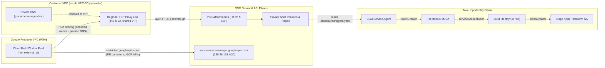

# Secure Source Manager and Cloud Build CI/CD

This project template brings up a private [Secure Source Manager](https://cloud.google.com/secure-source-manager/docs/overview) instance and the [Cloud Build](https://cloud.google.com/build/docs/overview) machinery that runs Terraform pipelines from its repositories inside a VPC Service Controls perimeter: a Cloud Build private worker pool with no external IPs, one repository-level service account (BYOSA) per repository, the per-repository build identities that pipelines run as, and the pair of regional internal TCP proxy load balancers through which workers reach the instance.

By default the instance uses Google-managed certificates (`ssm_config.ca_pool_id` and `custom_host_config` omitted) on its generated `*.<location>.p.sourcemanager.dev` hostnames; a Certificate Authority Service pool (`ca_pool_id` set) is also supported when custom hostnames or private PKI are required.

<!-- BEGIN TOC -->
- [Architecture and design choices](#architecture-and-design-choices)
  - [Two planes and the network path](#two-planes-and-the-network-path)
  - [Why not Developer Connect](#why-not-developer-connect)
  - [The identity chain and why this is not a FAST stage](#the-identity-chain-and-why-this-is-not-a-fast-stage)
- [Projects](#projects)
- [Landing zone configuration](#landing-zone-configuration)
  - [The private DNS zone for the instance hostnames](#the-private-dns-zone-for-the-instance-hostnames)
  - [The private service access peering for the Cloud Build private pool](#the-private-service-access-peering-for-the-cloud-build-private-pool)
  - [The delegation that lets build identities impersonate stage accounts](#the-delegation-that-lets-build-identities-impersonate-stage-accounts)
  - [Optional: custom hostnames and a Private CA pool](#optional-custom-hostnames-and-a-private-ca-pool)
- [The access path to the instance](#the-access-path-to-the-instance)
  - [The load balancer pair, for clients behind a peering](#the-load-balancer-pair-for-clients-behind-a-peering)
  - [Endpoints, the target design](#endpoints-the-target-design)
- [Repository pipeline configuration](#repository-pipeline-configuration)
- [Security note and repository governance](#security-note-and-repository-governance)
  - [Two branch rule settings are outside Terraform](#two-branch-rule-settings-are-outside-terraform)
- [Settled points and provider gaps](#settled-points-and-provider-gaps)
- [Example](#example)
- [Variables](#variables)
- [Outputs](#outputs)
<!-- END TOC -->

## Architecture and design choices

The design targets regulated environments with two hard constraints: Cloud Build workers must have no public IP address, and build API calls must be attributed to the customer's VPC Service Controls perimeter with the build's own service account as principal.



### Two planes and the network path

Secure Source Manager splits across two planes with different network properties. `securesourcemanager.googleapis.com` is an ordinary Google API served over `restricted.googleapis.com` (`199.36.153.4/30`), and it handles far more than instance lifecycle: instances, repositories, branch rules, pull requests, merges, and pull request comments all run over it without VPC connectivity, gated by VPC Service Controls and IAM alone. What lives exclusively on the instance's own `*.p.sourcemanager.dev` (or custom) hostnames — absent from both `private.googleapis.com` and `restricted.googleapis.com` — is the git HTTPS transport, SSH, and the web interface. Reaching git or the web UI therefore requires Private Service Connect, a private DNS zone, and a route from the client to whatever consumer fronts the instance's HTTP and SSH service attachments.

Because Cloud Build's Private Service Connect worker-pool integration is gated behind an allowlist and incomplete in the Terraform provider (see below), the worker pool uses private service access, placing workers in a Google-managed producer network peered to your VPC. Private Service Connect endpoint addresses are not transitive across VPC peering, whereas internal load balancer forwarding rules are, so this template fronts the two service attachments with a pair of regional internal TCP proxy load balancers sharing one VIP (`SHARED_LOADBALANCER_VIP`), and forwards `p.sourcemanager.dev.` across the peering via `peered_domains`. Both the worker pool and any CA pool must sit in the **same region as the instance**: Secure Source Manager creates triggered builds against Cloud Build's regional endpoint in the instance's region, and Cloud Build rejects a worker pool anywhere else (`400 workerpool location invalid`).

### Why not Developer Connect

Google's documentation offers Developer Connect (`REGION-git.developerconnect.dev`) as an alternative to Private Service Connect so Cloud Build does not need a VPC path to git. Three properties rule it out here: `google_developer_connect_connection` still has no Secure Source Manager block in the Terraform provider; the proxy is read-only (`git push` is blocked); and `*.developerconnect.dev` is served only on `private.googleapis.com` (`199.36.153.8/30`), not on `restricted.googleapis.com` (`199.36.153.4/30`). Routing `private.googleapis.com` into a `--no-public-egress` build network exposes un-perimetered Google APIs from build steps, defeating the perimeter's primary exfiltration control.

### The identity chain and why this is not a FAST stage

Secure Source Manager reads `.cloudbuild/triggers.yaml` from each repository's default branch and starts Cloud Build directly without `google_cloudbuild_trigger` resources. Two identities take part before Terraform impersonates anything:

1. **The triggering identity (per-repository BYOSA)** — calls Cloud Build when a push or pull request fires. By default Secure Source Manager uses its project-wide service agent for every repository; replacing it with one user-managed `service_account` per repository bounds which build identities a repository can ever reach to the exact accounts on which that BYOSA holds `roles/iam.serviceAccountUser`.
2. **The build identity (`<repo>-ro`, `<repo>-rw`)** — named in `serviceAccount:` inside `.cloudbuild/triggers.yaml`, executes the build steps, posts plan comments on pull requests, and holds `roles/iam.serviceAccountTokenCreator` on the downstream Terraform service accounts it may impersonate.

| grant on | principal | role |
| --- | --- | --- |
| each repository's BYOSA | Secure Source Manager service agent | `roles/iam.serviceAccountTokenCreator` |
| each repository's BYOSA | automation principal running this template | `roles/iam.serviceAccountUser` |
| each build identity of that repository | that repository's BYOSA | `roles/iam.serviceAccountUser` |
| the build project | each repository's BYOSA | `roles/cloudbuild.builds.editor`, `roles/cloudbuild.workerPoolUser`, `roles/serviceusage.serviceUsageConsumer` |
| the Secure Source Manager instance | each build identity | `roles/securesourcemanager.instanceAccessor` |
| the repository (never the project) | that repository's build identities | `roles/securesourcemanager.repoWriter` (default) |
| the build project | each build identity | `roles/logging.logWriter`, `roles/cloudbuild.workerPoolUser` |
| each target Terraform service account | the permitted build identity | `roles/iam.serviceAccountTokenCreator` |
| the CA pool's project (only when `ca_pool_id` is set) | Secure Source Manager service agent / build identities | `roles/privateca.certificateRequester` / `roles/privateca.auditor` |

In GitHub or GitLab Workload Identity Federation, the OIDC token carries the branch claim, so IAM binds apply privileges to `refs/heads/main` in a way a pipeline file cannot forge. Secure Source Manager has no equivalent claim: someone who can commit to the default branch edits `.cloudbuild/triggers.yaml` and chooses which build identity runs on `pull_request` versus `push`, while Cloud Build reads `.cloudbuild/cloudbuild.yaml` from the commit that fired the event (for a pull request, the unmerged pull request head). Shipping this as a native FAST stage would therefore appear to promise an IAM-enforced plan/apply boundary that actually rests on repository governance (branch protection, CODEOWNERS, and `requiredStatusChecks`). Kept as a project template, the boundary is explicit and documented under [Security note and repository governance](#security-note-and-repository-governance).

## Projects

Two project factory files describe the projects this configuration runs in: [`project-ssm.yaml`](./project-ssm.yaml) for the instance project, which also holds the automation seat spanning both, and [`project-build.yaml`](./project-build.yaml) for the build project, which is optional since the instance project can host the pool and the build identities too by leaving `projects_config.build` unset (`cloudbuild.googleapis.com` only needs to be enabled in whichever project runs the builds). They carry the APIs, the IAM the automation account needs, the `iam.disableCrossProjectServiceAccountUsage` exception the instance project needs because its repository service accounts create builds in the other project, the Shared VPC and perimeter memberships, and (commented out unless `ca_pool_id` is set) the certificate requester grant for the service agent. Enabling `securesourcemanager.googleapis.com` through the project factory also creates the Secure Source Manager service agent and grants `roles/securesourcemanager.serviceAgent` to it before the first instance is created. Edit the `TODO` lines, or use them as the list of what to create where a project factory is not available.

## Landing zone configuration

In the default Google-managed certificate mode, three pieces of the design sit outside this configuration because they belong to the network and to the bootstrap stage's service accounts rather than to the project; a fourth is added only when using custom hostnames or a Private CA pool. Where a FAST landing zone is in use they live in the networking, bootstrap and security stages; where one is not, they have to be created by whoever owns the VPC, the accounts a pipeline impersonates, and any CA pool.

### The private DNS zone for the instance hostnames

A private Secure Source Manager instance publishes its hostnames under `REGION.p.sourcemanager.dev`, and those names resolve nowhere useful by default. They appear in neither Private Google Access VIP domain list, so no private access configuration reaches a repository. A private zone attached to the VPC is the only way clients resolve them.

With the default generated names (`custom_host_config` omitted), root the private zone at `p.sourcemanager.dev.` rather than `REGION.p.sourcemanager.dev.`: four deterministic A records (`INSTANCE_ID-PROJECT_NUMBER.REGION`, `-api.REGION`, `-git.REGION` for HTTP and `-ssh.REGION` for SSH) can be written before the instance exists, and a single `p.sourcemanager.dev.` zone covers instances across any number of regions without shadowing public `sourcemanager.dev`. Since instance IDs are reusable after deletion, recreating the same `instance_id` in the same project preserves the four generated names; moving to a new project changes `PROJECT_NUMBER` and therefore every clone URL and DNS record name.

When `custom_host_config` is set (which requires `ca_pool_id`, below), the instance replaces the generated names outright with four of your own. The zone then covers your own domain (`api`, `git` and the apex resolving to the HTTP attachment and `ssh` to the SSH one), decoupling clone URLs and CI configs from the project number and region as well as from instance rebuilds. Note one client consequence: `git-credential-gcloud.sh` wraps `gcloud auth git-helper --ignore-unknown`, which only recognises Google's built-in git domains (`*.sourcemanager.dev`) and silently returns nothing for custom hostnames, so pipelines cloning from a custom git hostname need an explicit `oauth2` + `gcloud auth print-access-token` credential helper instead of `gcloud.sh`.

The records point at whatever fronts the attachments in the client's VPC, so the shape of DNS follows the access path section below. With the load balancer pair this configuration builds, that is one address network-wide, and one private zone in the hub serves every VPC that peers with it. With endpoints instead, each consumer VPC has its own pair of addresses and the answer differs per VPC: a response policy rule per VPC, or a private zone per VPC, both owned by the networking stage next to the endpoints themselves. The names are the same everywhere; only the addresses differ, which is what makes one hostname set serve every VPC.

The build workers need one more thing, because they sit on the producer side of a private service access peering and peering carries routes but not DNS. A worker resolves against the producer network's resolver and never sees the VPC's zones, so the route to the instance works while `git clone` fails at name resolution. The fix is a peered DNS domain on the peering — `peered_domains` inside `psa_configs` in `net-vpc` — naming the hostname suffix (`p.sourcemanager.dev.` by default, or your custom domain when `custom_host_config` is set).

Creating the zone in this configuration's own project instead is possible but costs more than it looks. Attaching a private zone to a VPC in another project is a cross-project bind, so the identity running Terraform needs `dns.networks.bindPrivateDNSZone` on the host project on top of `compute.networks.get`, and neither comes with any role you would otherwise grant it. No predefined role carries only the bind permission, so this means a custom role on the host project. Prefer the landing zone's DNS design where one exists.

### The private service access peering for the Cloud Build private pool

A Cloud Build private pool never runs in your VPC; the question is only how its workers reach it. With private service access, which is what Google's guide uses and what this configuration does, the workers run in a Google-managed producer VPC joined to yours by a service networking peering over a range you allocate. With Private Service Connect each worker would instead get an interface in a subnet of your own VPC through a network attachment. The second is the better design — no range, no exported routes, and the workers resolve against your VPC's resolver so nothing has to be forwarded — and it is not available end to end today, for two independent reasons: the API refuses `v1` pool creation carrying `privateServiceConnect` with `400 INVALID_ARGUMENT: Private Service Connect feature is unavailable` unless allowlisted, an error that Terraform and gcloud both hide by silently creating a networkless pool; and `google_cloudbuild_worker_pool` still lacks `public_ip_address_disabled`, which the API requires alongside the attachment, through provider 8.10.0. When both open, this configuration switches: one block on the pool resource, a network attachment and subnet in the landing zone in place of the peering, no peered domain, and no load balancers, since workers in the VPC use the same endpoints as every other client.

The peering needs a range, the exported subnet routes so the workers reach addresses in the VPC, and the peered DNS domain from the previous section:

```yaml
psa_configs:
  - ranges:
      psa-build: 10.8.200.0/24
    export_routes: true
    peered_domains:
      - p.sourcemanager.dev.
```

Google's guide also asks for `--no-export-subnet-routes-with-public-ip`, which `net-vpc` does not express; check the peering after the first apply (`exportSubnetRoutesWithPublicIp` defaults to `false`). Although the peering itself is VPC-wide, the worker pool must sit in the instance's region: Secure Source Manager creates triggered builds against Cloud Build's regional endpoint in the instance region, and Cloud Build rejects a `workerPool` in any other region (`400 workerpool location invalid`). Two consequences follow from private service access:

- `no_external_ip` on the pool maps to the peering's egress option and is what keeps the workers off the internet. There is no backstop: the workers run in a Google-managed tenant project in Google's own organisation, where `compute.vmExternalIpAccess` and every other policy of ours has no reach, and a pool with public egress can be created without complaint. A private-egress worker reaches Google APIs through Private Google Access and nothing else; container images and Terraform providers must therefore live in Artifact Registry or GCS inside the perimeter.
- The workers arrive from the peered range for firewall purposes, so ingress rules that admit them name `10.8.200.0/24` rather than a subnet.

Worker API traffic is attributed to the perimeter of the peered VPC's project: a build step calling an API the perimeter denies lands in that perimeter's audit logs (written on the VPC host project) with the worker's build service account as `principalEmail`.

The pool needs no service account of its own. An identity is named per build, in the triggers file, and the pool only has to admit it. A build identity does need `roles/logging.logWriter`, and that is less optional than it looks: a build running as a user-managed service account has no default log destination, so it must either write to Cloud Logging and say so with `CLOUD_LOGGING_ONLY`, or name a bucket. With neither, the build fails before it runs a step.

### The delegation that lets build identities impersonate stage accounts

One grant crosses an ownership line in every pipeline that manages landing zone infrastructure: `roles/iam.serviceAccountTokenCreator` on the Terraform service accounts a build identity impersonates. For application pipelines those accounts sit next to the application and nothing special is needed. For FAST stages they belong to the bootstrap stage, in the `iac-0` project, and this configuration's automation account has no right to set IAM on them.

Both ends of that edge are known here and nowhere else — the build identities are created here, the stage accounts are named in `repositories_config` — so this is where the grant is placed, and the bootstrap stage decides which of its accounts accept it. That decision is a delegation on each account rather than on the project: a conditioned binding on the service account resource, allowing this configuration's automation account to modify only `roles/iam.serviceAccountTokenCreator` on that one account. The set of stage accounts a build can ever impersonate is then the list of accounts carrying the binding, declared by their owner next to their definition, and an `impersonate_service_accounts` entry naming any other account fails the apply with a permission error, which is the right failure.

The role in that binding has to be a custom one. The only predefined role carrying `iam.serviceAccounts.setIamPolicy` is `roles/iam.serviceAccountAdmin`, which also carries delete, disable and key management, and the `modifiedGrantsByRole` condition does not restrain those: the attribute is only present on `setIamPolicy` requests, so on anything else `getAttribute(..., [])` yields an empty list and `hasOnly` passes. This is why Google's delegation examples pair the condition with `projectIamAdmin`, a role holding nothing but policy permissions. The equivalent for service accounts is an organization custom role with `iam.serviceAccounts.get`, `iam.serviceAccounts.getIamPolicy` and `iam.serviceAccounts.setIamPolicy`. In the bootstrap stage data that is one custom role file plus, per impersonable account, one binding:

```yaml
# organization/custom-roles/service_account_iam_admin.yaml
name: serviceAccountIamAdmin
includedPermissions:
  - iam.serviceAccounts.get
  - iam.serviceAccounts.getIamPolicy
  - iam.serviceAccounts.setIamPolicy
```

```yaml
# projects/core/iac-0.yaml, on each stage account builds may impersonate
service_accounts:
  iac-networking-ro:
    display_name: IaC service account for networking (read-only).
    iam_bindings_additive:
      ssm-build-delegation:
        role: $custom_roles:service_account_iam_admin
        member: $iam_principals:ssm-rw
        condition:
          title: SSM build identities delegation.
          expression: |
            api.getAttribute('iam.googleapis.com/modifiedGrantsByRole', [])
            .hasOnly(['roles/iam.serviceAccountTokenCreator'])
```

`ssm-rw` is a static `context.iam_principals` entry in the bootstrap stage's `defaults.yaml`, holding the automation account's email, since that account is created by the project factory and the bootstrap stage does not otherwise know it. The ordering is the natural one: the factory creates the account, the bootstrap stage is reapplied with the bindings, and this configuration can then place the grant.

### Optional: custom hostnames and a Private CA pool

The template supports two certificate modes through `ssm_config.ca_pool_id` (both immutable on the instance):

- **Default Google-managed certificates (`ca_pool_id` and `custom_host_config` omitted)** — the instance presents a publicly trusted Google Trust Services (`WR3`) certificate for its generated `<instance>-<project_number>{,-api,-git}.<location>.p.sourcemanager.dev` HTTPS hostnames. Because the internal TCP proxy passes TLS through untouched at layer 4, clients and Cloud Build workers verify TLS against their default trust store (`tls=0`) and authenticate with `git-credential-gcloud.sh` out of the box: no Certificate Authority Service pool, no `certificateRequester` or `privateca.auditor` grants or cross-project delegations, and no `get-ca-certs` chain fetch before `git clone`. Verified end to end inside an enforced VPC Service Controls perimeter restricting `securesourcemanager.googleapis.com` (although the VPC Service Controls supported products page still lists a Certificate Authority Service authority as a prerequisite, neither `CreateInstance` nor worker access requires one).
- **Private CA pool (`ca_pool_id` set, `custom_host_config` optional)** — Certificate Authority Service signs the instance certificate, which is required whenever `custom_host_config` sets custom hostnames (validated at plan time) or when an environment mandates private PKI. This configuration omits `roles/privateca.auditor` on build identities automatically when `ca_pool_id` is `null`, and grants it on the pool's project when `ca_pool_id` is set.

When `ca_pool_id` is set, the pool must allow CSR-based certificate requests, which is the default when no issuance policy is set, and the CA key must be 2048 bits (set an explicit `subject` on the CA rather than relying on module defaults). Either tier works: Secure Source Manager accepts a DevOps pool ($20 per CA per month vs $200 for Enterprise, where Enterprise adds listing, describing and revoking issued certificates). The pool's project is independent of the instance's; its location is not. A pool in another region fails `CreateInstance` with a misleading `P4SA_MISSING_PERMISSION` error and no audit log entry, so put the pool in the instance's region.

Uncomment `service_agents_project_bindings` in [`project-ssm.yaml`](./project-ssm.yaml) so the project factory grants `roles/privateca.certificateRequester` to the instance project's Secure Source Manager service agent on the CA pool's project, and delegate a conditioned `roles/resourcemanager.projectIamAdmin` on the CA pool's project (or its parent folder) to both the factory's automation account and this configuration's automation account:

```yaml
iam_bindings:
  ssm_ca_delegation:
    role: roles/resourcemanager.projectIamAdmin
    members:
      - $iam_principals:service_accounts/iac-0/iac-pf-rw
      - $iam_principals:service_accounts/dev-build-ssm-0/automation/rw
    condition:
      title: SSM delegated CA grants.
      expression: |
        api.getAttribute('iam.googleapis.com/modifiedGrantsByRole', []).hasOnly([
          'roles/privateca.certificateRequester',
          'roles/privateca.auditor'
        ])
```

Because the server sends only the leaf certificate with no intermediate, builds against a CAS-backed instance run `gcloud privateca pools get-ca-certs` (using `roles/privateca.auditor`) and pass the resulting PEM bundle to `git` before cloning; publishing the CA bundle to a GCS bucket or managed folder is an alternative that avoids granting `privateca.auditor` per build identity.

## The access path to the instance

A private instance publishes two Private Service Connect service attachments, one for HTTP and one for SSH, and both are computed rather than configured: the instance has no notion of a consumer and no way to create one. This configuration exposes them in the `service_attachments` output and builds one pair of internal proxy load balancers in front of them, in the VPC the build pool peers with. That pair exists for one client, the build workers, who reach the VPC over a peering that no Private Service Connect endpoint serves. Everything else that resolves the hostnames to the same address is a convenience that comes with it, and the target design, described second, has no load balancers at all.

### The load balancer pair, for clients behind a peering

A Private Service Connect endpoint does not serve clients that reach the VPC over VPC peering, and the build workers are exactly that: a private pool on private service access runs in a Google-managed producer network joined to yours by a peering. For the workers to reach the instance through their peering, the VPC needs something whose address the peering carries, and that is an internal load balancer's forwarding rule rather than an endpoint.

[ssm-load-balancers.tf](ssm-load-balancers.tf) builds two regional internal proxy load balancers with `net-lb-proxy-int`, each a PSC network endpoint group on one attachment, a backend service, a target TCP proxy and a forwarding rule, on 443 and 22, sharing one address reserved as `SHARED_LOADBALANCER_VIP` since the rules differ by port, with `global_access` on. The address can be pinned through `load_balancer_config.address`, and should be: the instance, and with it the attachments, are recreated on any change, and a pinned address keeps the DNS records true across a rebuild with nothing to update in the landing zone. Workers on the peering and clients in the hub resolve all four hostnames to that address and open both ports on it, receiving the instance's own certificate (either default Google-managed or signed by a Private CA pool when `ca_pool_id` is set). The proxy is layer 4 and terminates the TCP connection but not the TLS session, which is why default Google-managed certificates verify end to end without load-balancer certificates, why custom hostnames need `ca_pool_id` rather than the load balancer, and why SNI cannot collapse both services onto one port. A PSC NEG backend accepts only the `UTILIZATION` balancing mode (`CONNECTION` and `RATE` are rejected by the API).

Three things in the landing zone follow from the pair living in the instance project. The project needs `compute.googleapis.com` and the automation account `roles/compute.loadBalancerAdmin`, both in [project-ssm.yaml](project-ssm.yaml). The project must be a service project of the VPC's host, with `roles/compute.networkUser` at host project level for the automation account and the compute service agent; that is where the role belongs, and a subnet-scoped grant adds to it rather than narrowing it, as the settled points below explain. And the DNS records point at the one address from a zone every peered VPC sees, which in a hub and spoke built on peering is a zone in the hub plus the peered domain on the pool's private service access peering.

The single pair in the instance project serves the VPC it is in and everything peered with it. A VPC that is not peered, which is what a segregated environment design looks like, gets its own complete chain in its own project against the same attachments, with nothing shared between them and no peering group limits; the pair is what a landing zone's networking stage builds per VPC when staying on this model.

### Endpoints, the target design

With the pool on Private Service Connect the workers have an interface in the VPC like any other client, and the load balancers have no client left. Each consumer VPC then gets two Private Service Connect endpoints, one per attachment, created by the networking stage, because the address a client reaches the instance at is a property of the client's VPC and not of the instance's project. An endpoint is a forwarding rule aimed at an attachment with an address from one of the VPC's subnets, and it carries no ports: everything sent to the address goes to the attachment, so HTTP and SSH cannot share an address and each VPC ends up with two. The hostnames already allow for it, `api`, `git_http` and `html` resolving to the HTTP endpoint and `git_ssh` to the SSH one.

In the networking stage the endpoints are two `addresses.psc` entries in the VPC's `.config.yaml`, with the attachments named through the `service_attachments` context, whose values are static entries in the stage's `defaults.yaml` copied from this configuration's output after the instance is created:

```yaml
# 2-networking defaults.yaml
context:
  service_attachments:
    ssm-http: projects/abcdef-tp/regions/europe-west4/serviceAttachments/http-psc
    ssm-ssh: projects/abcdef-tp/regions/europe-west4/serviceAttachments/ssh-psc
```

```yaml
# 2-networking vpcs/dev/.config.yaml
addresses:
  psc:
    ssm-http:
      region: $locations:ssm
      subnet_self_link: $subnets:dev/europe-west4/gce
      service_attachment:
        psc_service_attachment_link: $service_attachments:ssm-http
        global_access: true
    ssm-ssh:
      region: $locations:ssm
      subnet_self_link: $subnets:dev/europe-west4/gce
      service_attachment:
        psc_service_attachment_link: $service_attachments:ssm-ssh
        global_access: true
```

`global_access` lets clients in other regions of the same VPC use the endpoint, which matters because Secure Source Manager runs in eleven regions and only two of them are in Europe, so the instance usually cannot sit in the region everything else uses. An endpoint is also reachable from on-premises over VPN or Interconnect, and across Network Connectivity Center spokes via propagated PSC connections, whereas a hub-and-spoke design built on VPC peering needs the load balancer pair in the hub.

The attachments move to a new tenant project on every instance rebuild, so the two context entries are the one thing downstream that has to be updated after a rebuild, and the hostnames are what keep everything else stable. Endpoint addresses are the ones the DNS records point at, and since every VPC has its own, DNS is per VPC: a response policy rule in each VPC, or a private zone per VPC, rather than the single hub zone the load balancer pair allows.

Two things must be right at instance creation because they are immutable. `psc_allowed_projects` is keyed on the project that owns the consumer resource, endpoint or network endpoint group, not on the host project of the network it connects from: a consumer created in a project outside the list, on a Shared VPC whose host project is inside it, sits at `pscConnectionStatus: PENDING` and never connects, while the same consumer in a listed project is `ACCEPTED` in seconds; every project in `psc_allowed_projects` must also belong to the same VPC Service Controls perimeter, or `CreateInstance` fails with an egress violation. The pair this configuration builds lives in the instance project, which is allowed implicitly; endpoints or chains created by the networking stage in each VPC's own project need those VPC projects listed, and naming a project costs nothing, so be generous. Check `pscConnectionStatus` on the forwarding rule or NEG first whenever a consumer is silent.

## Repository pipeline configuration

Ready-to-edit pipeline files live in [`pipeline-templates/triggers.yaml`](./pipeline-templates/triggers.yaml) (copied to `.cloudbuild/triggers.yaml` on the repository's default branch) and [`pipeline-templates/cloudbuild.yaml`](./pipeline-templates/cloudbuild.yaml) (copied to `.cloudbuild/cloudbuild.yaml`). Keep four behaviours in mind when adapting them:

- **`serviceAccount` is mandatory on every trigger entry.** Takes the full resource ID (`projects/PROJECT_ID/serviceAccounts/EMAIL`, exposed in `build_identities.<repo>/<id>.id`). Omitting `serviceAccount` on *any* entry causes Secure Source Manager to drop the entire `.cloudbuild/triggers.yaml` file silently before minting a BYOSA token — no UI banner, no commit status check, no audit log entry, and valid sibling triggers in the same file stop firing too. Setting `requiredStatusChecks` on the branch rule is what fails closed if someone breaks the file.
- **Pipelines clone the repository themselves.** Secure Source Manager passes an empty `sourceProvenance` (`{}`) to Cloud Build along with nine standard substitutions (`COMMIT_SHA`, `BRANCH_NAME`, `SHORT_SHA`, `TRIGGER_NAME`, `REPO_NAME`, `REPO_FULL_NAME`, `REF_NAME`, `REVISION_ID`, `TRIGGER_BUILD_CONFIG_PATH`), so the first step configures `git-credential-gcloud.sh` (or an `oauth2` token helper when custom hostnames are used), clones over the Private Service Connect git hostname, and checks out `$COMMIT_SHA`.
- **`CLOUD_LOGGING_ONLY` (or a custom logs bucket) is required.** User-managed build service accounts cannot write to Cloud Build's default logs bucket; without `logging: CLOUD_LOGGING_ONLY`, builds fail before executing step 0.
- **Repository `deletion_policy` defaults to `PREVENT` in the provider.** If an instance is ever replaced or torn down, Terraform cannot destroy child repositories unless `deletion_policy = "DELETE"` has already been applied to state on each `repositories_config` entry.

## Security note and repository governance

A person who can commit to a repository's default branch chooses both the identity a build runs as and the event that starts it, because both live in `.cloudbuild/triggers.yaml`. Meanwhile, Cloud Build reads `.cloudbuild/cloudbuild.yaml` from the commit that fired the event — which on a pull request is the unreviewed pull request head. Any `pull_request` trigger on the default branch is therefore a standing grant of its named build identity to everyone who can open a pull request against that repository. Three boundaries follow:

- **Repository isolation (IAM)** — comes from the set of act-as edges leaving each repository's BYOSA, which is why every repository gets its own service account and why `roles/iam.serviceAccountUser` and repository roles (`repoWriter` / `repoReader`) are granted on individual service accounts and repositories, never at project scope (note that Google's own PSC guide grants `repoReader` on the project, breaking isolation across repositories). The one act-as edge pointing at the BYOSA is the caller's (`projects_config.ssm.automation_principal`, derived from the provider identity when unset), because `CreateRepository` checks `iam.serviceAccounts.actAs` on the caller.
- **Plan-vs-apply separation (branch governance)** — comes from who may commit `.cloudbuild/triggers.yaml` to the default branch, so branch protection and CODEOWNERS carry weight here that IAM carries in Workload Identity Federation.
- **Blast radius of `pull_request` identities (IAM)** — comes solely from that identity's own permissions. Build identities default to `roles/securesourcemanager.repoWriter` on their own repository because `repoReader` omits `securesourcemanager.prcomments.create` (needed to post Terraform plan output on pull requests), while `repoWriter` neither approves pull requests nor bypasses branch rules, and anyone who can open a pull request already holds `repoWriter`. Remember that a plan identity able to read Terraform state exposes that state — and any secrets stored in it — to every pull request author on that repository.

### Two branch rule settings are outside Terraform

`google_secure_source_manager_branch_rule` currently lacks `requiredStatusChecks` and `requireCodeOwnerApproval`, although `projects.locations.repositories.branchRules` on `securesourcemanager.googleapis.com` exposes both over REST from outside the VPC as well as in the web interface. Configure both per repository after the branch rule is created, and again if the rule is recreated:

- **Required status checks** — add `Cloud Build / <trigger-name>`, which fails closed on both a failing build and an absent check (including when a trigger is removed or `.cloudbuild/triggers.yaml` is silently dropped). Two caveats apply: when an `includedFiles` filter skips a valid trigger, Secure Source Manager posts a passing check for `Cloud Build / <trigger-name>` so the pull request can merge; and `roles/securesourcemanager.repoAdmin` (or `roles/owner`) bypasses branch rules on `pullRequests:merge` unconditionally without a force flag, so human contributors should hold `repoWriter` rather than `repoAdmin`.
- **Require code owner approval** — without it CODEOWNERS is advisory, leaving the default-branch boundary resting on approval count alone.

## Settled points and provider gaps

- **Who places grants on resources this configuration does not own.** `roles/iam.serviceAccountTokenCreator` on stage Terraform accounts is placed here under a per-account conditioned delegation in the bootstrap stage; when `ca_pool_id` is set, `roles/privateca.auditor` is also placed here under a project-level delegation on the CA project.
- **What a consumer in a Shared VPC service project needs.** Both load balancers and endpoints require `roles/compute.networkUser` at host project level for the automation identity and the Compute Engine service agent. Subnet-scoped grants add to project-level bindings rather than restricting them; confining a service project to specific subnets is `compute.restrictSharedVpcSubnetworks`, an organisation policy.
- **Instance timing and immutability.** Instance creation takes roughly 30–36 minutes (120-minute provider timeout) and deletion roughly 20–25 minutes. Every instance field (`is_private`, `ca_pool`, `custom_host_config`, `psc_allowed_projects`, `kms_key`) is immutable; changing any of them replaces the instance and moves its service attachments to a new `<id>-tp` tenant project. Also note that `CreateRepository` with `initial_config.readme` running in the first second of instance readiness can return a transient `code 13 Internal error` that succeeds on immediate re-apply.
- **Provider gaps (through `hashicorp/google` 8.10.0).** Require `>= 7.44.0` for `service_account` on `google_secure_source_manager_repository`. Three upstream gaps remain: `requiredStatusChecks` and `requireCodeOwnerApproval` on `google_secure_source_manager_branch_rule`; a Secure Source Manager block on `google_developer_connect_connection`; and `public_ip_address_disabled` on `google_cloudbuild_worker_pool` alongside `private_service_connect`.

## Example

Every value that names something owned elsewhere — projects, networks, subnets, locations, custom roles, principals, the service accounts build identities impersonate, and any CA pool — accepts a context reference as well as a literal, resolved against the `context` variable with the usual `$key:name` form. By default the instance uses Google-managed certificates (`ca_pool_id` and `custom_host_config` omitted):

```hcl
module "ssm-cicd" {
  source = "./fabric/fast/project-templates/secure-source-manager-cicd"
  build_pool_config = {
    peered_network = "$networks:dev"
  }
  context = {
    iam_principals = {
      dev-build-ssm-0-rw = "serviceAccount:dev-build-ssm-0-rw@my-iac-0.iam.gserviceaccount.com"
    }
    locations = {
      ssm = "europe-west4"
    }
    networks = {
      dev = "projects/my-dev-net-spoke-0/global/networks/dev-spoke-0"
    }
    project_ids = {
      dev-build-pool-0 = "my-dev-build-pool-0"
      dev-build-ssm-0  = "my-dev-build-ssm-0"
      net-dev-0        = "my-dev-net-spoke-0"
      net-landing-0    = "my-prod-net-landing-0"
    }
    service_account_ids = {
      iac-vpcsc-ro = "projects/my-iac-0/serviceAccounts/iac-vpcsc-ro@my-iac-0.iam.gserviceaccount.com"
      iac-vpcsc-rw = "projects/my-iac-0/serviceAccounts/iac-vpcsc-rw@my-iac-0.iam.gserviceaccount.com"
    }
    subnets = {
      "dev/europe-west4/gce" = "projects/my-dev-net-spoke-0/regions/europe-west4/subnetworks/gce"
    }
  }
  load_balancer_config = {
    address    = "10.8.4.6"
    network    = "$networks:dev"
    subnetwork = "$subnets:dev/europe-west4/gce"
  }
  location = "$locations:ssm"
  prefix   = "test-0"
  projects_config = {
    build = {
      project_id = "$project_ids:dev-build-pool-0"
    }
    ssm = {
      number               = 1234567890
      project_id           = "$project_ids:dev-build-ssm-0"
      automation_principal = "$iam_principals:dev-build-ssm-0-rw"
    }
  }
  repositories_config = {
    vpcsc = {
      deletion_policy = "DELETE"
      description     = "FAST 1-vpcsc stage."
      build_identities = {
        ro = {
          impersonate_service_accounts = ["$service_account_ids:iac-vpcsc-ro"]
        }
        rw = {
          impersonate_service_accounts = ["$service_account_ids:iac-vpcsc-rw"]
        }
      }
      initial_config = {
        default_branch = "main"
      }
    }
  }
  ssm_config = {
    psc_allowed_projects = [
      "$project_ids:net-dev-0",
      "$project_ids:net-landing-0"
    ]
  }
}
# tftest modules=8 resources=32 inventory=default.yaml
```

To use custom hostnames signed by a Private CA pool instead, set `ca_pool_id` and `custom_host_config` (which also grants `roles/privateca.auditor` on the CA pool's project to each build identity):

```hcl
module "ssm-cicd" {
  source = "./fabric/fast/project-templates/secure-source-manager-cicd"
  build_pool_config = {
    peered_network = "$networks:dev"
  }
  context = {
    ca_pools = {
      dev = "projects/my-dev-sec-core/locations/europe-west4/caPools/dev-ca-0"
    }
    iam_principals = {
      dev-build-ssm-0-rw = "serviceAccount:dev-build-ssm-0-rw@my-iac-0.iam.gserviceaccount.com"
    }
    locations = {
      ssm = "europe-west4"
    }
    networks = {
      dev = "projects/my-dev-net-spoke-0/global/networks/dev-spoke-0"
    }
    project_ids = {
      dev-build-pool-0 = "my-dev-build-pool-0"
      dev-build-ssm-0  = "my-dev-build-ssm-0"
      net-dev-0        = "my-dev-net-spoke-0"
      net-landing-0    = "my-prod-net-landing-0"
    }
    service_account_ids = {
      iac-vpcsc-ro = "projects/my-iac-0/serviceAccounts/iac-vpcsc-ro@my-iac-0.iam.gserviceaccount.com"
      iac-vpcsc-rw = "projects/my-iac-0/serviceAccounts/iac-vpcsc-rw@my-iac-0.iam.gserviceaccount.com"
    }
    subnets = {
      "dev/europe-west4/gce" = "projects/my-dev-net-spoke-0/regions/europe-west4/subnetworks/gce"
    }
  }
  load_balancer_config = {
    address    = "10.8.4.6"
    network    = "$networks:dev"
    subnetwork = "$subnets:dev/europe-west4/gce"
  }
  location = "$locations:ssm"
  prefix   = "test-0"
  projects_config = {
    build = {
      project_id = "$project_ids:dev-build-pool-0"
    }
    ssm = {
      number               = 1234567890
      project_id           = "$project_ids:dev-build-ssm-0"
      automation_principal = "$iam_principals:dev-build-ssm-0-rw"
    }
  }
  repositories_config = {
    vpcsc = {
      description = "FAST 1-vpcsc stage."
      build_identities = {
        ro = {
          impersonate_service_accounts = ["$service_account_ids:iac-vpcsc-ro"]
        }
        rw = {
          impersonate_service_accounts = ["$service_account_ids:iac-vpcsc-rw"]
        }
      }
      initial_config = {
        default_branch = "main"
      }
    }
  }
  ssm_config = {
    ca_pool_id = "$ca_pools:dev"
    custom_host_config = {
      api      = "api.ssm.example.com"
      git_http = "git.ssm.example.com"
      git_ssh  = "ssh.ssm.example.com"
      html     = "ssm.example.com"
    }
    psc_allowed_projects = [
      "$project_ids:net-dev-0",
      "$project_ids:net-landing-0"
    ]
  }
}
# tftest modules=8 resources=34 inventory=context.yaml
```
<!-- BEGIN TFDOC -->
## Variables

| name | description | type | required | default |
|---|---|:---:|:---:|:---:|
| [build_pool_config](variables.tf#L17) | Cloud Build private worker pool, peered with the VPC over private service access. | <code>object&#40;&#123;&#8230;&#125;&#41;</code> | ✓ |  |
| [load_balancer_config](variables.tf#L44) | Internal proxy load balancer pair in front of the instance service attachments, for the build workers behind their peering. | <code>object&#40;&#123;&#8230;&#125;&#41;</code> | ✓ |  |
| [location](variables.tf#L54) | Region for the instance, the load balancers, the build pool, and any CA pool. | <code>string</code> | ✓ |  |
| [projects_config](variables.tf#L77) | Instance project with its number, and optional build project defaulting to the instance project. The automation principal is derived from the provider identity when null. | <code>object&#40;&#123;&#8230;&#125;&#41;</code> | ✓ |  |
| [context](variables.tf#L28) | Context-specific interpolations. | <code>object&#40;&#123;&#8230;&#125;&#41;</code> |  | <code>&#123;&#125;</code> |
| [name](variables.tf#L60) | Base name for the instance and the build pool, prefixed with the prefix. | <code>string</code> |  | <code>&#34;ssm-0&#34;</code> |
| [prefix](variables.tf#L67) | Optional prefix for resource names. | <code>string</code> |  | <code>null</code> |
| [repositories_config](variables.tf#L92) | Repositories, each with its own service account and the build identities its pipelines run as. | <code>map&#40;object&#40;&#123;&#8230;&#125;&#41;&#41;</code> |  | <code>&#123;&#125;</code> |
| [ssm_config](variables.tf#L129) | Instance configuration; ca_pool_id, custom_host_config and psc_allowed_projects are immutable. | <code>object&#40;&#123;&#8230;&#125;&#41;</code> |  | <code>&#123;&#125;</code> |

## Outputs

| name | description | sensitive |
|---|---|:---:|
| [build_identities](outputs.tf#L17) | Build identity service accounts, keyed <repository>/<identity>; id is what a triggers file names in serviceAccount. |  |
| [build_pool_id](outputs.tf#L27) | Cloud Build private worker pool id. |  |
| [load_balancer_address](outputs.tf#L32) | Shared VIP of the load balancer pair, which the DNS records point at. |  |
| [repository_service_accounts](outputs.tf#L37) | Repository-level service account emails, by repository. |  |
| [service_attachments](outputs.tf#L42) | PSC service attachments of the instance, to be fronted by endpoints in each consumer VPC; the networking stage takes them as service_attachments context entries. They change on every instance rebuild. |  |
| [ssm_instance](outputs.tf#L50) | Instance id, hostnames and repository ids. |  |
<!-- END TFDOC -->
