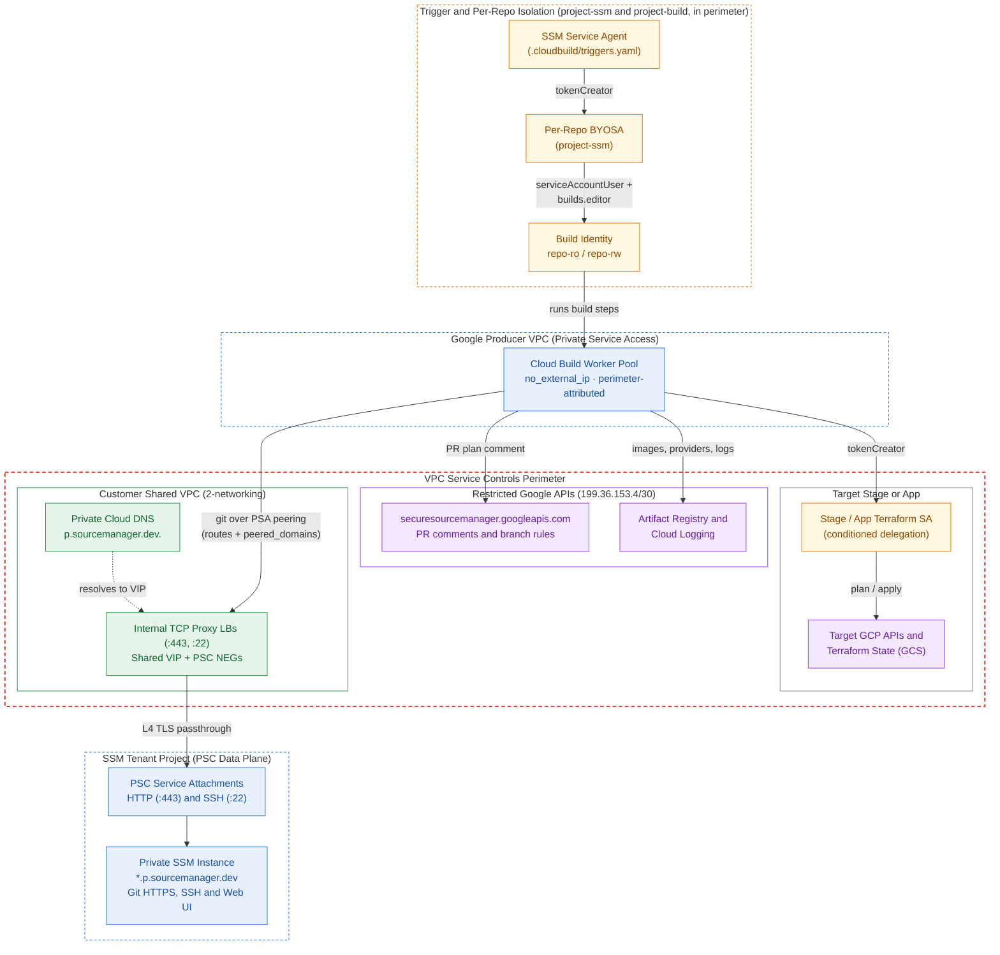

# Secure Source Manager and Cloud Build CI/CD

This project template deploys a private [Secure Source Manager](https://cloud.google.com/secure-source-manager/docs/overview) instance and a [Cloud Build](https://cloud.google.com/build/docs/overview) environment that runs Terraform pipelines inside a VPC Service Controls perimeter. It creates 4 groups of resources:

- a Cloud Build private worker pool with no external IP addresses
- one user-managed service account (BYOSA) per repository
- per-repository build identities that pipelines run as
- 2 regional internal TCP proxy load balancers that connect build workers to the instance

By default, the instance uses Google-managed certificates on its generated `*.<location>.p.sourcemanager.dev` hostnames when you omit `ssm_config.ca_pool_id` and `custom_host_config`. You can also pass a Certificate Authority Service pool in `ca_pool_id` when you need custom hostnames or private PKI.

<!-- BEGIN TOC -->
- [Architecture and design choices](#architecture-and-design-choices)
  - [API plane and instance hostnames](#api-plane-and-instance-hostnames)
  - [Why this template skips Developer Connect](#why-this-template-skips-developer-connect)
  - [Identity chain and template boundary](#identity-chain-and-template-boundary)
- [Projects](#projects)
- [Landing zone configuration](#landing-zone-configuration)
  - [Private DNS for instance hostnames](#private-dns-for-instance-hostnames)
  - [Private service access for the Cloud Build pool](#private-service-access-for-the-cloud-build-pool)
  - [Delegating stage account impersonation](#delegating-stage-account-impersonation)
  - [Custom hostnames and Private CA pools](#custom-hostnames-and-private-ca-pools)
- [Reaching the instance](#reaching-the-instance)
  - [Internal load balancers for peered clients](#internal-load-balancers-for-peered-clients)
  - [Private Service Connect endpoints](#private-service-connect-endpoints)
- [Repository pipeline configuration](#repository-pipeline-configuration)
- [Security model and repository governance](#security-model-and-repository-governance)
  - [Branch rule settings outside Terraform](#branch-rule-settings-outside-terraform)
- [Operational notes and provider gaps](#operational-notes-and-provider-gaps)
- [Example](#example)
- [Variables](#variables)
- [Outputs](#outputs)
<!-- END TOC -->

## Architecture and design choices

This template fits regulated environments with 2 requirements: Cloud Build workers have no public IP addresses, and build API calls enter your VPC Service Controls perimeter with the build's own service account as principal.



### API plane and instance hostnames

Secure Source Manager serves its control plane and its repository endpoints over 2 separate network paths.

The control plane runs on `securesourcemanager.googleapis.com`, which is a standard Google API reachable over `restricted.googleapis.com` (`199.36.153.4/30`). It handles instances, repositories, branch rules, pull requests, merges, and pull request comments without VPC connectivity, controlled by VPC Service Controls and IAM.

The git HTTPS transport, SSH transport, and web interface run on the instance's own `*.p.sourcemanager.dev` or custom hostnames, and neither `private.googleapis.com` nor `restricted.googleapis.com` serves them. To reach git or the web UI, a client needs Private Service Connect, a private DNS zone, and a route to the consumer resource in front of the instance's HTTP and SSH service attachments.

This template connects the Cloud Build worker pool over private service access, placing workers in a Google-managed producer network peered to your VPC, because Cloud Build's Private Service Connect worker pool integration is still behind an allowlist and incomplete in the Terraform provider. VPC peering exports routes to internal load balancer forwarding rules and ignores Private Service Connect endpoint addresses, so this template places 2 regional internal TCP proxy load balancers in front of the service attachments on one shared VIP (`SHARED_LOADBALANCER_VIP`) and forwards `p.sourcemanager.dev.` across the peering through `peered_domains`.

Keep the instance, the worker pool, and any CA pool in the same region, because Secure Source Manager submits triggered builds to Cloud Build's regional endpoint in the instance region and Cloud Build rejects a worker pool in another region with `400 workerpool location invalid`.

### Why this template skips Developer Connect

Google's documentation describes Developer Connect (`REGION-git.developerconnect.dev`) as a way for Cloud Build to reach git without a VPC path. That approach fails 3 requirements of this setup:

- `google_developer_connect_connection` has no Secure Source Manager block in the Terraform provider
- the Developer Connect proxy is read-only and blocks `git push`
- `*.developerconnect.dev` resolves only on `private.googleapis.com` (`199.36.153.8/30`) and is absent from `restricted.googleapis.com` (`199.36.153.4/30`)

Routing `private.googleapis.com` into a `--no-public-egress` build network exposes un-perimetered Google APIs to build steps, which defeats the perimeter's main exfiltration control.

### Identity chain and template boundary

Secure Source Manager reads `.cloudbuild/triggers.yaml` from each repository's default branch and starts Cloud Build directly without `google_cloudbuild_trigger` resources. Before Terraform impersonates a target account, 2 service accounts handle each build.

The triggering identity is a per-repository user-managed service account (BYOSA) that calls Cloud Build when a push or pull request fires. Secure Source Manager defaults to its shared project service agent across every repository, so assigning one `service_account` per repository restricts that repository to the build identities on which its BYOSA holds `roles/iam.serviceAccountUser`.

The build identity (`<repo>-ro` or `<repo>-rw`), named in `serviceAccount:` inside `.cloudbuild/triggers.yaml`, runs the build steps, posts plan comments on pull requests, and holds `roles/iam.serviceAccountTokenCreator` on the downstream Terraform service accounts it impersonates.

| grant on | principal | role |
| --- | --- | --- |
| each repository's BYOSA | Secure Source Manager service agent | `roles/iam.serviceAccountTokenCreator` |
| each repository's BYOSA | automation principal running this template | `roles/iam.serviceAccountUser` |
| each build identity of that repository | that repository's BYOSA | `roles/iam.serviceAccountUser` |
| the build project | each repository's BYOSA | `roles/cloudbuild.builds.editor`, `roles/cloudbuild.workerPoolUser`, `roles/serviceusage.serviceUsageConsumer` |
| the Secure Source Manager instance | each build identity | `roles/securesourcemanager.instanceAccessor` |
| each repository | that repository's build identities | `roles/securesourcemanager.repoWriter` (default) |
| the build project | each build identity | `roles/logging.logWriter`, `roles/cloudbuild.workerPoolUser` |
| each target Terraform service account | the permitted build identity | `roles/iam.serviceAccountTokenCreator` |
| the CA pool's project (when `ca_pool_id` is set) | Secure Source Manager service agent / build identities | `roles/privateca.certificateRequester` / `roles/privateca.auditor` |

In GitHub or GitLab Workload Identity Federation, the OIDC token carries the branch claim, so IAM binds apply privileges to `refs/heads/main` and a pipeline file cannot forge that claim. Secure Source Manager issues no branch claim, so anyone who can commit to the default branch can edit `.cloudbuild/triggers.yaml` and pick which build identity runs on `pull_request` or `push`. Cloud Build then reads `.cloudbuild/cloudbuild.yaml` from the commit that fired the event, which on a pull request is the unmerged pull request head.

FAST stages enforce the boundary between plan and apply in IAM, but here that boundary depends on repository governance: branch protection, CODEOWNERS, and `requiredStatusChecks`. We ship this design as a project template so that boundary stays explicit; see [Security model and repository governance](#security-model-and-repository-governance).

## Projects

This directory includes 2 project factory files. [`project-ssm.yaml`](./project-ssm.yaml) configures the instance project and the automation service account that manages the whole deployment. [`project-build.yaml`](./project-build.yaml) configures a separate build project and is optional: if you leave `projects_config.build` unset, the instance project hosts the worker pool and build identities too, and `cloudbuild.googleapis.com` only needs to be enabled in whichever project runs the builds.

Together, the 2 files configure:

- required APIs and IAM roles for the automation service account
- an `iam.disableCrossProjectServiceAccountUsage` exception on the instance project so its repository service accounts can start builds in the build project
- Shared VPC service project attachment and VPC Service Controls perimeter membership
- a commented-out `roles/privateca.certificateRequester` grant for the service agent, needed only when `ca_pool_id` is set

Enabling `securesourcemanager.googleapis.com` through the project factory also creates the Secure Source Manager service agent and grants it `roles/securesourcemanager.serviceAgent` before Terraform creates the first instance. Edit the `TODO` lines for your FAST landing zone, or use the files as a checklist when you create the projects elsewhere.

## Landing zone configuration

With default Google-managed certificates, 3 settings live outside this template because they belong to the shared VPC and the bootstrap stage's service accounts. A fourth setting applies when you use custom hostnames or a Private CA pool. In a FAST landing zone, configure them in the networking, bootstrap, and security stages; otherwise, have the owners of the VPC, target Terraform service accounts, and CA pool apply them.

### Private DNS for instance hostnames

Attach a private Cloud DNS zone to the VPC so that clients can resolve the instance hostnames. A private Secure Source Manager instance publishes its default hostnames under `REGION.p.sourcemanager.dev`, which has no public records and is absent from both Private Google Access VIP domain lists, so clients have no other way to resolve them.

When you use the default generated hostnames (`custom_host_config` omitted), create the private zone at `p.sourcemanager.dev.`. One `p.sourcemanager.dev.` zone covers instances in every region without shadowing public `sourcemanager.dev`, and you can create all 4 deterministic A records before the instance exists: `INSTANCE_ID-PROJECT_NUMBER.REGION`, `-api.REGION`, and `-git.REGION` for HTTP, plus `-ssh.REGION` for SSH. Secure Source Manager lets you reuse an `instance_id` after deletion, so recreating the same `instance_id` in the same project keeps all 4 generated names, but moving to a new project changes `PROJECT_NUMBER` and updates every clone URL and DNS record.

When you set `custom_host_config` (which requires `ca_pool_id`), the instance replaces the generated hostnames with 4 names of your own. Your private zone then covers your custom domain, with `api`, `git`, and the apex pointing to the HTTP address and `ssh` pointing to the SSH address, which decouples clone URLs and CI files from the project number, region, and instance rebuilds. Custom hostnames change how clients authenticate to git: `git-credential-gcloud.sh` calls `gcloud auth git-helper --ignore-unknown`, which only recognizes `*.sourcemanager.dev` and returns nothing for custom domains, so pipelines must configure an `oauth2` credential helper backed by `gcloud auth print-access-token`.

Point the DNS records at whichever consumer fronts the service attachments in the client's VPC:

- with the load balancer pair in this template, all 4 records share one VIP across the network, and one private zone in the hub serves every peered VPC
- with Private Service Connect endpoints, each consumer VPC allocates its own HTTP and SSH addresses, needs its own response policy rules or private zone in the networking stage, and resolves the same hostnames to those local addresses

Forward the DNS suffix across the worker pool peering as well. Build workers run on the producer side of the private service access peering. VPC peering exports routes to the producer network, but the producer resolver cannot see your VPC's private DNS zones, so `git clone` fails name resolution until you add `p.sourcemanager.dev.` (or your custom domain) to `peered_domains` under `psa_configs` in `net-vpc`.

Keep the private DNS zone in your networking stage, because creating it inside this template's project requires cross-project VPC binding. That binding needs `dns.networks.bindPrivateDNSZone` and `compute.networks.get` on the host project, which means creating a custom role on the host project because no predefined role grants the bind permission on its own.

### Private service access for the Cloud Build pool

Configure a private service access peering on your VPC with an allocated IP range, exported custom routes so workers can reach the internal load balancer VIP, and the peered DNS domain:

```yaml
psa_configs:
  - ranges:
      psa-build: 10.8.200.0/24
    export_routes: true
    peered_domains:
      - p.sourcemanager.dev.
```

Google's documentation also passes `--no-export-subnet-routes-with-public-ip`, and the `net-vpc` module leaves `exportSubnetRoutesWithPublicIp` at its API default of `false`, so you only need to verify that setting on the peering after the first apply. The peering spans the whole VPC, but the worker pool itself must sit in the same region as the Secure Source Manager instance, or Cloud Build returns `400 workerpool location invalid`.

Private service access places workers in a Google-managed tenant project inside Google's own organization, which has 3 operational consequences:

- `no_external_ip` on the worker pool sets the peering egress mode and is the sole control keeping workers off the internet, because your organization policies such as `compute.vmExternalIpAccess` do not apply to Google's tenant project
- private-egress workers reach Google APIs exclusively through Private Google Access, so container images and Terraform providers must live in Artifact Registry or Cloud Storage inside the perimeter
- firewall ingress rules that match build workers must use the peered IP range (`10.8.200.0/24` above) as the source range

VPC Service Controls attributes worker API calls to the perimeter of the peered VPC's host project. When the perimeter denies an API call from a build step, the violation appears in the VPC host project's audit logs with the build identity as `principalEmail`.

The worker pool itself takes no service account; `.cloudbuild/triggers.yaml` names the build identity on each trigger. Every user-managed build identity requires `roles/logging.logWriter` and either `logging: CLOUD_LOGGING_ONLY` or a custom logs bucket in `cloudbuild.yaml`, because user-managed accounts cannot write to Cloud Build's default logs bucket and builds fail before step 0 without an explicit log destination.

Private Service Connect network attachments will eventually replace private service access here, giving each worker a NIC in your own subnet with direct access to your VPC resolver and Private Service Connect endpoints, and removing the IP range, route export, peered DNS domain, and load balancers. This template stays on private service access today because of 2 upstream blockers: the Cloud Build `v1` API rejects `privateServiceConnect` with `400 INVALID_ARGUMENT: Private Service Connect feature is unavailable` unless the project is allowlisted (which Terraform and `gcloud` mask by creating a pool with no network config), and `google_cloudbuild_worker_pool` lacks the required `public_ip_address_disabled` field through provider `8.10.0`.

### Delegating stage account impersonation

Pipelines that deploy FAST stages need `roles/iam.serviceAccountTokenCreator` on stage Terraform service accounts owned by `0-bootstrap` in the `iac-0` project, which sits outside the projects that this template manages. For application pipelines whose Terraform service accounts live in the application's own project, no cross-stage delegation is needed.

This template creates the build identities and reads the target stage accounts from `repositories_config`, so it places the `roles/iam.serviceAccountTokenCreator` bindings itself, and the bootstrap stage controls which stage accounts accept them. On each stage service account that builds may impersonate, add a conditioned IAM binding that allows this template's automation service account to grant `roles/iam.serviceAccountTokenCreator` on that single service account. Any `impersonate_service_accounts` entry pointing to an account without that delegation fails `terraform apply` with a permission error.

Use a custom organization role for that delegation. The predefined `roles/iam.serviceAccountAdmin` role includes delete, disable, and key-creation permissions that `modifiedGrantsByRole` cannot block, because IAM populates `iam.googleapis.com/modifiedGrantsByRole` only on `setIamPolicy` calls; on other methods `getAttribute(..., [])` returns an empty list and `hasOnly` evaluates to true. For the same reason that Google's project-level delegation examples pair `modifiedGrantsByRole` with `roles/resourcemanager.projectIamAdmin`, service-account delegation pairs it with a custom role holding only `iam.serviceAccounts.get`, `iam.serviceAccounts.getIamPolicy`, and `iam.serviceAccounts.setIamPolicy`:

```yaml
# organization/custom-roles/service_account_iam_admin.yaml
name: serviceAccountIamAdmin
includedPermissions:
  - iam.serviceAccounts.get
  - iam.serviceAccounts.getIamPolicy
  - iam.serviceAccounts.setIamPolicy
```

```yaml
# projects/core/iac-0.yaml, on each stage account builds may impersonate
service_accounts:
  iac-networking-ro:
    display_name: IaC service account for networking (read-only).
    iam_bindings_additive:
      ssm-build-delegation:
        role: $custom_roles:service_account_iam_admin
        member: $iam_principals:ssm-rw
        condition:
          title: SSM build identities delegation.
          expression: |
            api.getAttribute('iam.googleapis.com/modifiedGrantsByRole', [])
            .hasOnly(['roles/iam.serviceAccountTokenCreator'])
```

Define `ssm-rw` as a static `context.iam_principals` entry in `0-bootstrap`'s `defaults.yaml` with the email of the automation account created by the project factory. Apply the project factory first to create the automation account, reapply `0-bootstrap` to add the delegations, and then apply this template.

### Custom hostnames and Private CA pools

`ssm_config.ca_pool_id` selects between 2 certificate modes on the instance, and changing either `ca_pool_id` or `custom_host_config` replaces the instance.

When you omit `ca_pool_id` and `custom_host_config`, Secure Source Manager provisions publicly trusted Google Trust Services (`WR3`) certificates for `<instance>-<project_number>{,-api,-git}.<location>.p.sourcemanager.dev`. Because the internal TCP proxy forwards TLS unchanged at layer 4, clients and Cloud Build workers verify the certificate against their default system trust store (`tls=0`) and authenticate with `git-credential-gcloud.sh` directly, with no CA pool, no `privateca` IAM grants or delegations, and no certificate chain download before `git clone`. This default mode works inside an enforced VPC Service Controls perimeter protecting `securesourcemanager.googleapis.com`. The VPC Service Controls supported products page still lists a Certificate Authority Service pool as a requirement, but neither `CreateInstance` nor worker access needs one.

When you set `ca_pool_id` (required whenever `custom_host_config` is set, or when your organization requires private PKI), Certificate Authority Service signs the instance certificate, and this template automatically grants `roles/privateca.auditor` on the CA pool's project to every build identity.

Configure the CA pool in the same region as the Secure Source Manager instance, because a pool in another region fails `CreateInstance` with a `P4SA_MISSING_PERMISSION` error and writes no audit log entry. The CA pool can live in any project, must allow CSR-based certificate requests (the default when no issuance policy is set), and must use a 2048-bit RSA CA key with an explicit `subject`. Both CA pool tiers work: DevOps ($20 per CA per month) and Enterprise ($200 per CA per month, which adds listing, describing, and revoking issued certificates).

When using `ca_pool_id`, uncomment `service_agents_project_bindings` in [`project-ssm.yaml`](./project-ssm.yaml) so the project factory grants `roles/privateca.certificateRequester` to the Secure Source Manager service agent on the CA pool's project, and delegate a conditioned `roles/resourcemanager.projectIamAdmin` binding on the CA pool's project (or parent folder) to both the project factory automation account and this template's automation account:

```yaml
iam_bindings:
  ssm_ca_delegation:
    role: roles/resourcemanager.projectIamAdmin
    members:
      - $iam_principals:service_accounts/iac-0/iac-pf-rw
      - $iam_principals:service_accounts/dev-build-ssm-0/automation/rw
    condition:
      title: SSM delegated CA grants.
      expression: |
        api.getAttribute('iam.googleapis.com/modifiedGrantsByRole', []).hasOnly([
          'roles/privateca.certificateRequester',
          'roles/privateca.auditor'
        ])
```

Because a CAS-backed instance sends only its leaf certificate during the TLS handshake, pipelines run `gcloud privateca pools get-ca-certs` (using `roles/privateca.auditor`) and pass the PEM bundle to `git` before cloning. You can also publish the CA bundle to a Cloud Storage bucket or managed folder if you want to skip per-build `roles/privateca.auditor` grants.

## Reaching the instance

A private Secure Source Manager instance exposes 2 read-only Private Service Connect service attachments, one for HTTP and one for SSH, which this template re-exports in `service_attachments`. The template also deploys 2 internal TCP proxy load balancers in front of those attachments inside the VPC peered with the Cloud Build worker pool, so workers across the peering can reach the instance. Once Cloud Build worker pools support Private Service Connect network attachments directly, Private Service Connect endpoints in each consumer VPC can replace the load balancers altogether.

### Internal load balancers for peered clients

Build workers on private service access reach your VPC across VPC peering, which routes to internal load balancer forwarding rules and ignores Private Service Connect endpoints.

[`ssm-load-balancers.tf`](./ssm-load-balancers.tf) uses `net-lb-proxy-int` to create 2 regional internal TCP proxy load balancers on ports `443` and `22`. Each load balancer pairs a Private Service Connect network endpoint group (NEG) pointing at one service attachment with a backend service (`UTILIZATION` balancing mode, because the API rejects `CONNECTION` and `RATE` on PSC NEGs), a target TCP proxy, and a forwarding rule with `global_access` enabled. Both forwarding rules share one internal IP address reserved with `SHARED_LOADBALANCER_VIP`.

Pin that VIP in `load_balancer_config.address` so DNS records remain valid if the instance and its service attachments are ever recreated. Because the target TCP proxy operates at layer 4 and passes TLS straight through to the instance, clients see the instance's own Google-managed or CAS-signed certificate without configuring certificates on the load balancer; for the same reason, custom hostnames must be configured on the instance with `ca_pool_id`, and HTTP and SSH must stay on separate ports because SNI routing is unavailable.

Hosting the load balancers in the instance project requires 3 settings in the landing zone:

- `compute.googleapis.com` enabled on the instance project and `roles/compute.loadBalancerAdmin` granted to the automation account, both included in [`project-ssm.yaml`](./project-ssm.yaml)
- the instance project attached as a Shared VPC service project, with `roles/compute.networkUser` granted at the host project level to the automation account and the Compute Engine service agent
- DNS A records pointing to the shared VIP in a private zone visible to peered VPCs (for example, in a hub VPC), paired with `peered_domains` on the worker pool's private service access peering

One load balancer pair in the instance project serves its own VPC and every VPC peered with it. Unpeered VPCs in segregated environments cannot use that peering, so they deploy their own load balancer pair (or endpoints) in their own projects against the same `service_attachments` outputs, which also avoids VPC peering group limits.

### Private Service Connect endpoints

When clients live directly inside a VPC (or once the Cloud Build worker pool uses a Private Service Connect network attachment), each consumer VPC can connect to the instance through 2 Private Service Connect endpoints managed by `2-networking`. An endpoint is a subnet-IP forwarding rule pointing directly at a service attachment across all ports, so HTTP and SSH require separate IP addresses: `api`, `git_http`, and `html` resolve to the HTTP endpoint, and `git_ssh` resolves to the SSH endpoint.

In `2-networking`, copy the `service_attachments` output from this template into `defaults.yaml` after creating the instance, and add 2 `addresses.psc` entries in each consumer VPC's `.config.yaml`:

```yaml
# 2-networking defaults.yaml
context:
  service_attachments:
    ssm-http: projects/abcdef-tp/regions/europe-west4/serviceAttachments/http-psc
    ssm-ssh: projects/abcdef-tp/regions/europe-west4/serviceAttachments/ssh-psc
```

```yaml
# 2-networking vpcs/dev/.config.yaml
addresses:
  psc:
    ssm-http:
      region: $locations:ssm
      subnet_self_link: $subnets:dev/europe-west4/gce
      service_attachment:
        psc_service_attachment_link: $service_attachments:ssm-http
        global_access: true
    ssm-ssh:
      region: $locations:ssm
      subnet_self_link: $subnets:dev/europe-west4/gce
      service_attachment:
        psc_service_attachment_link: $service_attachments:ssm-ssh
        global_access: true
```

Setting `global_access: true` lets clients in other regions of the same VPC reach the endpoint, which is often needed because Secure Source Manager is available in 11 regions (2 of them in Europe). Private Service Connect endpoints also work from on-premises networks over Cloud VPN or Cloud Interconnect, and across Network Connectivity Center spokes through propagated PSC connections. Hub-and-spoke topologies built on VPC peering use the internal load balancer pair in the hub instead.

If an instance is replaced, its service attachments move to a new tenant project, so you update the 2 `service_attachments` entries in `defaults.yaml` and keep your existing DNS names and endpoint IPs. Because each consumer VPC owns its own endpoint IP addresses, configure DNS per VPC with a Cloud DNS response policy or a per-VPC private zone.

Check 2 immutable `psc_allowed_projects` rules before creating the instance:

- list the project that owns each consumer forwarding rule or PSC NEG, because Secure Source Manager evaluates `psc_allowed_projects` against the consumer resource's project (a consumer in an unlisted Shared VPC service project stays at `pscConnectionStatus: PENDING` even when the Shared VPC host project is listed, whereas a consumer in a listed project reaches `ACCEPTED` in seconds; the instance's own project is allowed automatically)
- ensure every project in `psc_allowed_projects` belongs to the same VPC Service Controls perimeter, or `CreateInstance` fails with an egress violation

Adding extra perimeter projects to `psc_allowed_projects` upfront avoids recreating the instance later, because `psc_allowed_projects` cannot be changed in place. When a consumer fails to connect, check `pscConnectionStatus` on the forwarding rule or PSC NEG first.

## Repository pipeline configuration

Copy [`pipeline-templates/triggers.yaml`](./pipeline-templates/triggers.yaml) to `.cloudbuild/triggers.yaml` on each repository's default branch, and copy [`pipeline-templates/cloudbuild.yaml`](./pipeline-templates/cloudbuild.yaml) to `.cloudbuild/cloudbuild.yaml`. Keep 4 rules in mind when editing them.

Every trigger entry in `.cloudbuild/triggers.yaml` must set `serviceAccount` to the full resource ID (`projects/PROJECT_ID/serviceAccounts/EMAIL`, exposed in `build_identities.<repo>/<id>.id`). If any entry omits `serviceAccount`, Secure Source Manager silently ignores the entire `.cloudbuild/triggers.yaml` file before minting a BYOSA token, with no UI warning, commit status check, or audit log entry, and valid sibling triggers in the same file stop firing too. Configuring `requiredStatusChecks` on the branch rule catches a broken triggers file, because merges block whenever the expected check is missing.

Your pipeline steps must clone the repository explicitly, because Secure Source Manager sends an empty `sourceProvenance` (`{}`) to Cloud Build along with 9 substitutions (`COMMIT_SHA`, `BRANCH_NAME`, `SHORT_SHA`, `TRIGGER_NAME`, `REPO_NAME`, `REPO_FULL_NAME`, `REF_NAME`, `REVISION_ID`, `TRIGGER_BUILD_CONFIG_PATH`). The first build step configures `git-credential-gcloud.sh` (or an `oauth2` token helper for custom hostnames), clones over the Private Service Connect git hostname, and checks out `$COMMIT_SHA`.

Set `options.logging: CLOUD_LOGGING_ONLY` (or specify a custom logs bucket) in `.cloudbuild/cloudbuild.yaml`, because user-managed build service accounts cannot write to Cloud Build's default logs bucket and builds fail before step 0 without a log destination.

Set `deletion_policy = "DELETE"` in state on each `repositories_config` entry before replacing an instance or tearing down repositories, because the Terraform provider defaults repository `deletion_policy` to `PREVENT`.

## Security model and repository governance

Anyone who can commit to a repository's default branch controls `.cloudbuild/triggers.yaml`, which selects both the build identity and the trigger event. At build time, Cloud Build reads `.cloudbuild/cloudbuild.yaml` from the commit that fired the event, which on a pull request is the unreviewed pull request head. Adding a `pull_request` trigger on the default branch therefore grants its build identity to everyone who can open a pull request on that repository.

Repository and trigger access rests on 3 controls.

Repository isolation comes from IAM on the per-repository BYOSA. Each repository gets its own service account, and this template grants `roles/iam.serviceAccountUser` and repository roles (`repoWriter` or `repoReader`) on individual service accounts and individual repositories, keeping project-level IAM clean so one repository cannot act as another's build identities or read another repository. Granting `repoReader` on the project, as shown in Google's PSC guide, would let every build identity read every repository on the instance. The caller running Terraform (`projects_config.ssm.automation_principal`, or the provider identity when null) also receives `roles/iam.serviceAccountUser` on each BYOSA because `CreateRepository` checks `iam.serviceAccounts.actAs` on the caller.

Separation between `plan` and `apply` comes from branch governance on the default branch, because committers to the default branch control `.cloudbuild/triggers.yaml`. Branch protection and CODEOWNERS carry the enforcement role here that OIDC branch claims carry in Workload Identity Federation.

The blast radius of a `pull_request` build comes from the permissions of its build identity. Build identities default to `roles/securesourcemanager.repoWriter` on their own repository because `repoReader` lacks `securesourcemanager.prcomments.create` for posting Terraform plan comments; `repoWriter` cannot approve pull requests or bypass branch rules, and any pull request author already holds `repoWriter`. Remember that a `plan` identity with read access to Terraform state exposes that state and any secrets in it to anyone who can open a pull request against the repository.

### Branch rule settings outside Terraform

`google_secure_source_manager_branch_rule` lacks `requiredStatusChecks` and `requireCodeOwnerApproval` in the Terraform provider, but `projects.locations.repositories.branchRules` on `securesourcemanager.googleapis.com` exposes both over REST from outside the VPC and in the web UI. Configure both settings on each repository after Terraform creates its branch rule, and reapply them if the branch rule is recreated.

For `requiredStatusChecks`, require `Cloud Build / <trigger-name>` so merges block when a build fails, when a trigger is deleted, or when Secure Source Manager drops a malformed `.cloudbuild/triggers.yaml`. Keep 2 behaviors in mind: when an `includedFiles` filter skips a trigger, Secure Source Manager posts a passing `Cloud Build / <trigger-name>` check so the pull request can still merge; and `roles/securesourcemanager.repoAdmin` (or `roles/owner`) bypasses branch rules on `pullRequests:merge` without a force flag, so grant human contributors `repoWriter` and reserve `repoAdmin` for break-glass use.

Enable `requireCodeOwnerApproval` so CODEOWNERS is enforced on merges; without it, CODEOWNERS is advisory and any reviewer approval satisfies the branch rule.

## Operational notes and provider gaps

On Shared VPC service projects, both internal load balancers and Private Service Connect endpoints require `roles/compute.networkUser` at the host project level for the automation account and the Compute Engine service agent. Subnet-level bindings only add permissions on top of project-level ones, so restricting which subnets a service project can use requires the `compute.restrictSharedVpcSubnetworks` organization policy.

Instance creation takes 30 to 36 minutes (with a 120-minute provider timeout) and deletion takes 20 to 25 minutes. Every instance attribute (`is_private`, `ca_pool`, `custom_host_config`, `psc_allowed_projects`, and `kms_key`) is immutable, so changing any of them replaces the instance and moves its service attachments to a new `<id>-tp` tenant project. If `CreateRepository` with `initial_config.readme` runs in the first second after an instance reports ready, the API can return a transient `code 13 Internal error` that succeeds when you rerun `terraform apply`.

This template requires `hashicorp/google` `>= 7.44.0` for `service_account` on `google_secure_source_manager_repository`. Through provider `8.10.0`, 3 upstream provider gaps remain:

- `requiredStatusChecks` and `requireCodeOwnerApproval` on `google_secure_source_manager_branch_rule`
- a Secure Source Manager source block on `google_developer_connect_connection`
- `public_ip_address_disabled` alongside `private_service_connect` on `google_cloudbuild_worker_pool`

## Example

Every variable field that references external resources (projects, networks, subnets, locations, custom roles, IAM principals, target Terraform service accounts, and CA pools) accepts either a literal ID or a `$namespace:key` reference resolved from `context`. The default configuration uses Google-managed certificates (`ca_pool_id` and `custom_host_config` omitted):

```hcl
module "ssm-cicd" {
  source = "./fabric/fast/project-templates/secure-source-manager-cicd"
  build_pool_config = {
    peered_network = "$networks:dev"
  }
  context = {
    iam_principals = {
      dev-build-ssm-0-rw = "serviceAccount:dev-build-ssm-0-rw@my-iac-0.iam.gserviceaccount.com"
    }
    locations = {
      ssm = "europe-west4"
    }
    networks = {
      dev = "projects/my-dev-net-spoke-0/global/networks/dev-spoke-0"
    }
    project_ids = {
      dev-build-pool-0 = "my-dev-build-pool-0"
      dev-build-ssm-0  = "my-dev-build-ssm-0"
      net-dev-0        = "my-dev-net-spoke-0"
      net-landing-0    = "my-prod-net-landing-0"
    }
    service_account_ids = {
      iac-vpcsc-ro = "projects/my-iac-0/serviceAccounts/iac-vpcsc-ro@my-iac-0.iam.gserviceaccount.com"
      iac-vpcsc-rw = "projects/my-iac-0/serviceAccounts/iac-vpcsc-rw@my-iac-0.iam.gserviceaccount.com"
    }
    subnets = {
      "dev/europe-west4/gce" = "projects/my-dev-net-spoke-0/regions/europe-west4/subnetworks/gce"
    }
  }
  load_balancer_config = {
    address    = "10.8.4.6"
    network    = "$networks:dev"
    subnetwork = "$subnets:dev/europe-west4/gce"
  }
  location = "$locations:ssm"
  prefix   = "test-0"
  projects_config = {
    build = {
      project_id = "$project_ids:dev-build-pool-0"
    }
    ssm = {
      number               = 1234567890
      project_id           = "$project_ids:dev-build-ssm-0"
      automation_principal = "$iam_principals:dev-build-ssm-0-rw"
    }
  }
  repositories_config = {
    vpcsc = {
      deletion_policy = "DELETE"
      description     = "FAST 1-vpcsc stage."
      build_identities = {
        ro = {
          impersonate_service_accounts = ["$service_account_ids:iac-vpcsc-ro"]
        }
        rw = {
          impersonate_service_accounts = ["$service_account_ids:iac-vpcsc-rw"]
        }
      }
      initial_config = {
        default_branch = "main"
      }
    }
  }
  ssm_config = {
    psc_allowed_projects = [
      "$project_ids:net-dev-0",
      "$project_ids:net-landing-0"
    ]
  }
}
# tftest modules=8 resources=32 inventory=default.yaml
```

To use custom hostnames signed by a Private CA pool, set `ca_pool_id` and `custom_host_config`, which also grants `roles/privateca.auditor` on the CA pool's project to each build identity:

```hcl
module "ssm-cicd" {
  source = "./fabric/fast/project-templates/secure-source-manager-cicd"
  build_pool_config = {
    peered_network = "$networks:dev"
  }
  context = {
    ca_pools = {
      dev = "projects/my-dev-sec-core/locations/europe-west4/caPools/dev-ca-0"
    }
    iam_principals = {
      dev-build-ssm-0-rw = "serviceAccount:dev-build-ssm-0-rw@my-iac-0.iam.gserviceaccount.com"
    }
    locations = {
      ssm = "europe-west4"
    }
    networks = {
      dev = "projects/my-dev-net-spoke-0/global/networks/dev-spoke-0"
    }
    project_ids = {
      dev-build-pool-0 = "my-dev-build-pool-0"
      dev-build-ssm-0  = "my-dev-build-ssm-0"
      net-dev-0        = "my-dev-net-spoke-0"
      net-landing-0    = "my-prod-net-landing-0"
    }
    service_account_ids = {
      iac-vpcsc-ro = "projects/my-iac-0/serviceAccounts/iac-vpcsc-ro@my-iac-0.iam.gserviceaccount.com"
      iac-vpcsc-rw = "projects/my-iac-0/serviceAccounts/iac-vpcsc-rw@my-iac-0.iam.gserviceaccount.com"
    }
    subnets = {
      "dev/europe-west4/gce" = "projects/my-dev-net-spoke-0/regions/europe-west4/subnetworks/gce"
    }
  }
  load_balancer_config = {
    address    = "10.8.4.6"
    network    = "$networks:dev"
    subnetwork = "$subnets:dev/europe-west4/gce"
  }
  location = "$locations:ssm"
  prefix   = "test-0"
  projects_config = {
    build = {
      project_id = "$project_ids:dev-build-pool-0"
    }
    ssm = {
      number               = 1234567890
      project_id           = "$project_ids:dev-build-ssm-0"
      automation_principal = "$iam_principals:dev-build-ssm-0-rw"
    }
  }
  repositories_config = {
    vpcsc = {
      description = "FAST 1-vpcsc stage."
      build_identities = {
        ro = {
          impersonate_service_accounts = ["$service_account_ids:iac-vpcsc-ro"]
        }
        rw = {
          impersonate_service_accounts = ["$service_account_ids:iac-vpcsc-rw"]
        }
      }
      initial_config = {
        default_branch = "main"
      }
    }
  }
  ssm_config = {
    ca_pool_id = "$ca_pools:dev"
    custom_host_config = {
      api      = "api.ssm.example.com"
      git_http = "git.ssm.example.com"
      git_ssh  = "ssh.ssm.example.com"
      html     = "ssm.example.com"
    }
    psc_allowed_projects = [
      "$project_ids:net-dev-0",
      "$project_ids:net-landing-0"
    ]
  }
}
# tftest modules=8 resources=34 inventory=context.yaml
```
<!-- BEGIN TFDOC -->
## Variables

| name | description | type | required | default |
|---|---|:---:|:---:|:---:|
| [build_pool_config](variables.tf#L17) | Cloud Build private worker pool configuration. | <code>object&#40;&#123;&#8230;&#125;&#41;</code> | ✓ |  |
| [load_balancer_config](variables.tf#L44) | Regional internal TCP proxy load balancer configuration for the instance service attachments. | <code>object&#40;&#123;&#8230;&#125;&#41;</code> | ✓ |  |
| [location](variables.tf#L54) | Region for the instance, load balancers, worker pool, and optional CA pool. | <code>string</code> | ✓ |  |
| [projects_config](variables.tf#L77) | Instance project with its number, and optional build project defaulting to the instance project. The automation principal is derived from the provider identity when null. | <code>object&#40;&#123;&#8230;&#125;&#41;</code> | ✓ |  |
| [context](variables.tf#L28) | Context-specific interpolations. | <code>object&#40;&#123;&#8230;&#125;&#41;</code> |  | <code>&#123;&#125;</code> |
| [name](variables.tf#L60) | Base name for the instance and the worker pool. | <code>string</code> |  | <code>&#34;ssm-0&#34;</code> |
| [prefix](variables.tf#L67) | Optional prefix for resource names. | <code>string</code> |  | <code>null</code> |
| [repositories_config](variables.tf#L92) | Repositories to create, with per-repository service accounts and build identities. | <code>map&#40;object&#40;&#123;&#8230;&#125;&#41;&#41;</code> |  | <code>&#123;&#125;</code> |
| [ssm_config](variables.tf#L129) | Secure Source Manager instance settings. All fields are immutable after creation. | <code>object&#40;&#123;&#8230;&#125;&#41;</code> |  | <code>&#123;&#125;</code> |

## Outputs

| name | description | sensitive |
|---|---|:---:|
| [build_identities](outputs.tf#L17) | Build identity service accounts, keyed by <repository>/<identity>. Set serviceAccount in triggers.yaml to id. |  |
| [build_pool_id](outputs.tf#L27) | Cloud Build private worker pool ID. |  |
| [load_balancer_address](outputs.tf#L32) | Shared VIP of the internal load balancer pair for DNS A records. |  |
| [repository_service_accounts](outputs.tf#L37) | Per-repository service account emails, keyed by repository. |  |
| [service_attachments](outputs.tf#L42) | PSC service attachments for the instance HTTP and SSH endpoints. Recreated when the instance is replaced. |  |
| [ssm_instance](outputs.tf#L50) | Instance ID, hostnames, and repository IDs. |  |
<!-- END TFDOC -->
