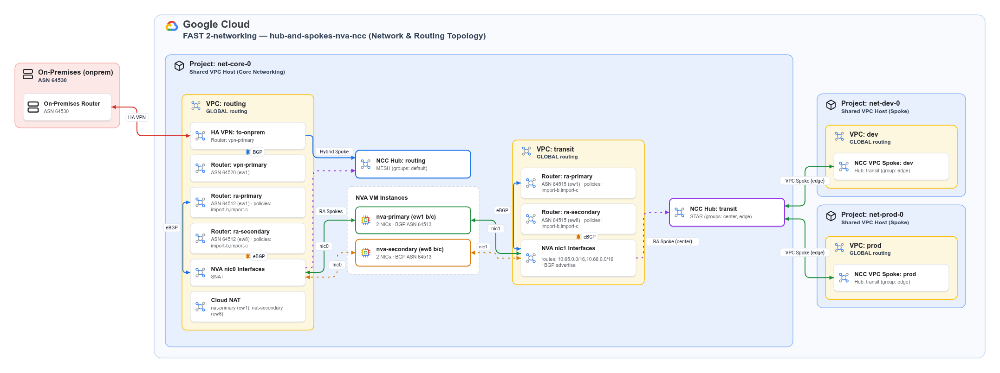
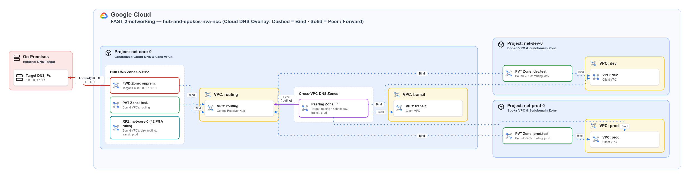

# Hub and spoke with NVAs as NCC Router Appliances

This dataset builds a hub-and-spoke network where network virtual appliances (NVAs) inspect traffic between spoke VPCs, between spokes and on-premises, and toward the internet. The NVAs attach to 2 [Network Connectivity Center (NCC)](https://cloud.google.com/network-connectivity/docs/network-connectivity-center) hubs as [Router Appliance spokes](https://cloud.google.com/network-connectivity/docs/network-connectivity-center/concepts/ra-overview) and exchange routes over BGP with regional Cloud Routers. This layout follows the [Cross-Cloud Network with NVAs and regional failover using NCC](https://docs.cloud.google.com/architecture/ccn-distributed-apps-design/ccn-ncc-nva) reference architecture.

<p align="center">
  
</p>

## VPC and NCC layout

The dataset creates 4 global-routing VPCs across 2 regions (`europe-west1` as primary and `europe-west8` as secondary) and connects them across 2 NCC hubs:

- `routing` VPC (project `net-core-0`, `10.64.0.0/24` and `10.64.1.0/24`) hosts the HA VPN to on-premises in [vpcs/routing/vpns/onprem.yaml](./vpcs/routing/vpns/onprem.yaml), regional Cloud NAT gateways for internet egress, the NVA `nic0` interfaces, and the `ra-*` Cloud Routers. It attaches to the `routing` mesh hub in [ncc-hubs/routing.yaml](./ncc-hubs/routing.yaml) through the HA VPN hybrid spoke and the NVA `nic0` Router Appliance spokes.
- `transit` VPC (project `net-core-0`, `10.64.16.0/24` and `10.64.17.0/24`) hosts the NVA `nic1` interfaces and the transit `ra-*` Cloud Routers. It attaches to the `transit` star hub in [ncc-hubs/transit.yaml](./ncc-hubs/transit.yaml) through the NVA `nic1` Router Appliance spokes in the `center` group. Do not place workloads in `transit`: the star hub exports `transit` subnet routes directly to edge spokes, so forward traffic from workloads to `transit` would bypass the NVAs.
- `prod` (`10.65.x.0/24` in `net-prod-0`) and `dev` (`10.66.x.0/24` in `net-dev-0`) workload Shared VPCs attach to the `transit` star hub in the `edge` group. Edge spokes in a star hub only exchange routes with `center` spokes, which forces all east-west traffic between `prod` and `dev` through an NVA.

## NVA configuration

The dataset defines one NVA file per region in [nvas/primary.yaml](./nvas/primary.yaml) and [nvas/secondary.yaml](./nvas/secondary.yaml). Each file creates 2 instances (`b` in zone `b` and `c` in zone `c`):

```yaml
auto_instance_config:
  image: projects/cos-cloud/global/images/family/cos-stable
  instance_type: e2-standard-2
  nics:
    - network: $networks:routing
      subnet: $subnets:routing/europe-west1/routing-primary
      masquerade: true
      masquerade_exclude:
        - 10.0.0.0/8
        - 172.16.0.0/12
        - 192.168.0.0/16
        - 100.64.0.0/10
    - network: $networks:transit
      routes:
        - 10.65.0.0/16
        - 10.66.0.0/16
      advertise:
        - 10.65.0.0/24
        - 10.66.0.0/24
        - 10.65.1.0/24
        - 10.66.1.0/24
      bgp_inbound_deny:
        - 0.0.0.0/0
      subnet: $subnets:transit/europe-west1/transit-primary
instance_groups:
  b:
    auto_create_instances: 1
  c:
    auto_create_instances: 1
ncc_ra_config:
  spokes:
    - network: $networks:routing
      hub: $ncc_hubs:routing
    - network: $networks:transit
      hub: $ncc_hubs:transit
      group: $ncc_groups:transit/center
bgp_config:
  asn: 64513
  keepalive: 3
  holdtime: 9
```

The NVA attributes work as follows:

- `masquerade` and `masquerade_exclude` on `nic0` (`routing`) apply source NAT only to internet-bound traffic. Private destinations in `masquerade_exclude` keep their original workload source IP toward on-premises and survive an active-to-standby failover without resetting NAT state.
- `bgp_inbound_deny: ["0.0.0.0/0"]` on `nic1` (`transit`) drops any default route received from the transit Cloud Routers so internet and north-south egress always leaves through `nic0`.
- `instance_groups` is keyed by zone letter and creates instances named `nva-<nva>-<zone>-<index>`, exposed as `<nva>-<zone>-<index>` (`primary-b-0`) in `$nva_instances:` and `$nva_addresses:`. Unmanaged instance groups are created only when `ilb_config.forwarding_rules` is non-empty.
- `ncc_ra_config.spokes` creates one Router Appliance spoke per VPC (`ra-<vpc>-<nva>`) with `site_to_site_data_transfer: true` and `include_import_ranges: ["ALL_IPV4_RANGES"]` by default. You can also register externally managed appliances under `instances` (`vm`, `ip`, and optional `name`) without setting `auto_instance_config` or `instance_groups`.
- `bgp_config` boots Container-Optimized OS with [assets/nva-startup-script-frr.yaml.tpl](../../assets/nva-startup-script-frr.yaml.tpl), runs FRR in a container, derives BGP neighbors from the Cloud Router peers that reference the NVA, and writes [assets/frr.conf.tpl](../../assets/frr.conf.tpl) to the `nva-frr-config` instance metadata key. A background daemon on the VM polls `nva-frr-config` every 30 seconds and reloads FRR in place (~1 s graceful restart) without recreating the VM.

### Why `nic1` needs both `routes` and `advertise`

`routes` and `advertise` on `nic1` configure the guest Linux kernel and the FRR BGP daemon separately:

- `routes` configures the data plane in the guest Linux kernel (used in both ILB and BGP modes). The startup script runs `ip route replace <prefix> via <subnet-gateway> dev eth1` for `10.65.0.0/16` and `10.66.0.0/16` so the kernel knows to forward workload packets out `eth1` (`transit`). `routes` does not advertise anything over BGP.
- `advertise` configures the control plane in FRR (used only in BGP mode). It adds `network <prefix>` statements in `frr.conf.tpl` so every NVA originates the 4 workload `/24` subnets (`10.65.0.0/24`, `10.66.0.0/24`, `10.65.1.0/24`, `10.66.1.0/24`) toward all Cloud Routers on both `routing` and `transit`. Origination is required because edge spokes in the `transit` star hub cannot see each other's subnet routes directly, and FRR's per-NIC split-horizon filter blocks reflecting a route learned from a `transit` Cloud Router back into `transit`.
- Both settings are required together because FRR assigns locally originated `network` statements a BGP weight of `32768`, which beats any eBGP route (weight `0`) received from Cloud Router. FRR therefore never installs a BGP route in the Linux kernel for prefixes in `advertise`. Without the covering `/16` static kernel `routes` on `nic1`, the NVA would attract workload traffic over BGP and send it out `eth0`'s default route. Setting `no bgp network import-check` in `frr.conf.tpl` lets `routes` use aggregated `/16` supernets while `advertise` originates individual `/24` subnets.

### Replacing NVA instances

GCP blocks deleting a VM while a Router Appliance spoke (HTTP 412) or a Cloud Router BGP peer (HTTP 400) references it. The factory uses `terraform_data` triggers (`replace_triggered_by`) to destroy an NVA's spokes and peers before replacing its VM and recreate them afterward. If you want to rebuild one zone at a time without dropping both zones' BGP sessions during `terraform apply`, split each zone into its own NVA YAML file (`primary-b.yaml` and `primary-c.yaml`) so each instance owns separate spokes and peers.

## Routing, flow symmetry and active-passive vs active-active

### Why asymmetric routing happens

An NVA sits between 2 separate VPC routing tables (`routing` on `nic0` and `transit` on `nic1`). The ingress VPC routes the forward leg of a connection, and the egress VPC routes the return leg independently. If the forward leg crosses one NVA instance and the return leg crosses another, stateful functions on the NVA (stateful firewall rules, Linux `conntrack`, or SNAT) drop or reset the connection unless the instances synchronize session state.

Two sources of asymmetry exist in a multi-region deployment:

1. Intra-region asymmetry between instances in the same region: if 2 instances in `europe-west1` (`primary-b-0` and `primary-c-0`) advertise routes with the same MED, Cloud Router installs equal-cost multipath (ECMP) routes across both instances. Because `routing` and `transit` hash the forward and return legs independently, half of all connections hit one instance on the forward leg and the other instance on the return leg.
2. Inter-region asymmetry across global VPCs: even with a single active instance per region, `GLOBAL` VPC routing splits flows across regions if every regional Cloud Router assigns `MED = 100` to all routes from its local NVA:
   - For north-south traffic (`routing` to a workload spoke), traffic entering `routing` in `europe-west1` for an `europe-west8` workload (`10.65.1.0/24`) would use `primary-b-0` in `europe-west1` (local priority `100` beats remote priority `100 + 215`), while the return traffic from `europe-west8` to on-premises would use `secondary-b-0` in `europe-west8`.
   - For cross-region east-west traffic (`europe-west1` workload to `europe-west8` workload), the `europe-west1` VM would send traffic through `primary-b-0`, while the `europe-west8` VM would send the reply through `secondary-b-0`.

### How Cloud Router import policies enforce symmetry

All NVAs share ASN `64513` (which prevents BGP loops between regions via AS-path check) and keep FRR MED-neutral (`attribute-unchanged med`). Every path decision is made on the Cloud Routers through `IMPORT` route policies in [vpcs/routing/.config.yaml](./vpcs/routing/.config.yaml) and [vpcs/transit/.config.yaml](./vpcs/transit/.config.yaml).

Cloud Router uses the imported MED as the route priority and adds an inter-region penalty when a VPC uses a route from another region (measured at `215` between `europe-west1` and `europe-west8`). By assigning a base `offset` (`100` for active, `150` for standby, or `100` on all instances for ECMP) and adding `+10000` to demoted prefixes, the import policies keep both legs of every flow on the same regional cluster:

| Router | Matched prefixes | MED set by policy | Routing outcome |
|---|---|---|---|
| `routing` routers, any region | Workload prefixes of the router's own region | `offset` (`100` or `150`) | Uses the local region's NVA for north-south traffic to local workloads |
| `routing` routers, any region | All other prefixes (`0.0.0.0/0.orLonger()`) | `10000 + offset` (`10100` or `10150`) | Reaches remote workloads through their own region's NVA (`100 + 215 = 315` beats `10100`); local NVAs act as cross-region backup |
| `transit` routers, region rank `r` | Workload prefixes of regions ranked above `r` | `10000 + offset` (`10100` or `10150`) | Sends cross-region east-west traffic through the higher-ranked region's NVA in both directions (`315` beats `10100`) |
| `transit` routers, any region | All other prefixes (`0.0.0.0/0`, on-premises, own and lower-ranked workloads) | `offset` (`100` or `150`) | Uses the local region's NVA for same-region east-west, north-south egress, and internet egress |

In this dataset `europe-west1` is rank 1 and `europe-west8` is rank 2. On `transit`, `ra-primary` (`europe-west1`) only needs the catch-all term (`offset`), while `ra-secondary` (`europe-west8`) demotes `europe-west1`'s workload prefixes (`10.65.0.0/24`, `10.66.0.0/24`) to `10000 + offset`. If both NVAs in one region fail, the `10100` / `10150` routes in the surviving region take over symmetrically in both directions.

### Default mode: active-passive (no session sync required)

By default, this dataset runs active-passive in each region (`b` active with `offset = 100`, `c` standby with `offset = 150`). This mode requires no session synchronization between NVA instances because every flow uses the `b` instance in both directions and only switches to `c` when `b` goes down.

To assign different MEDs to `b` and `c`, each Cloud Router in [vpcs/routing/.config.yaml](./vpcs/routing/.config.yaml) and [vpcs/transit/.config.yaml](./vpcs/transit/.config.yaml) defines 2 route policies (`import-b` and `import-c`) and 4 explicit per-instance peers (`address` + `router_appliance_instance`, 2 per instance across `intf-0` and `intf-1`):

```yaml
routers:
  ra-primary:
    region: $locations:primary
    asn: 64512
    custom_advertise:
      all_subnets: true
      ip_ranges:
        "0.0.0.0/0": default
    interfaces:
      intf-0:
        subnet: $subnets:routing/europe-west1/routing-primary
        ip_address: 10.64.0.252
      intf-1:
        subnet: $subnets:routing/europe-west1/routing-primary
        ip_address: 10.64.0.253
        redundant_interface: intf-0
    route_policies:
      import-b:
        type: IMPORT
        terms:
          - priority: 10
            match:
              expression: "destination.inAnyRange([prefix('10.65.0.0/24').orLonger(), prefix('10.66.0.0/24').orLonger()])"
            actions:
              - expression: med.set(100)
              - expression: accept()
          - priority: 20
            match:
              expression: "destination.inAnyRange(prefix('0.0.0.0/0').orLonger())"
            actions:
              - expression: med.set(10100)
              - expression: accept()
      import-c:
        # same terms with med.set(150) and med.set(10150)
    peers:
      primary-b-0:
        interface: intf-0
        asn: 64513
        address: $nva_addresses:primary-b-0/routing
        router_appliance_instance: $nva_instances:primary-b-0
        import_policies: [import-b]
      primary-b-1:
        interface: intf-1
        asn: 64513
        address: $nva_addresses:primary-b-0/routing
        router_appliance_instance: $nva_instances:primary-b-0
        import_policies: [import-b]
      primary-c-0:
        interface: intf-0
        asn: 64513
        address: $nva_addresses:primary-c-0/routing
        router_appliance_instance: $nva_instances:primary-c-0
        import_policies: [import-c]
      primary-c-1:
        interface: intf-1
        asn: 64513
        address: $nva_addresses:primary-c-0/routing
        router_appliance_instance: $nva_instances:primary-c-0
        import_policies: [import-c]
```

### Configuring active-active ECMP (stateless or session-synced NVAs)

Use active-active ECMP only when your NVA is stateless or synchronizes firewall and NAT state across instances in the same region. Under ECMP, the regional `+10000` tie-breaker still keeps both directions of a flow inside the same regional NVA cluster, while `routing` and `transit` hash forward and return packets independently across the `N` instances in that region (`1/N` chance of hitting the same instance in both directions).

To switch a region from active-passive to active-active ECMP (across up to 8 instances per Router Appliance spoke), you do not need to change `nvas/primary.yaml` or `nvas/secondary.yaml`. In [vpcs/routing/.config.yaml](./vpcs/routing/.config.yaml) and [vpcs/transit/.config.yaml](./vpcs/transit/.config.yaml), keep a single route policy (`import-b` with `100` and `10100`) and replace the 4 explicit per-instance peers with 2 fan-out peers (`nva: primary`, one per interface):

```yaml
# Active-active ECMP replacement in vpcs/routing/.config.yaml (ra-primary)
    route_policies:
      import-ecmp:
        type: IMPORT
        terms:
          - priority: 10
            match:
              expression: "destination.inAnyRange([prefix('10.65.0.0/24').orLonger(), prefix('10.66.0.0/24').orLonger()])"
            actions:
              - expression: med.set(100)
              - expression: accept()
          - priority: 20
            match:
              expression: "destination.inAnyRange(prefix('0.0.0.0/0').orLonger())"
            actions:
              - expression: med.set(10100)
              - expression: accept()
    peers:
      # `nva: primary` fans out a BGP session to every instance of `primary`
      # (`primary-b-0`, `primary-c-0`, ...) with the same import policy
      primary-0:
        interface: intf-0
        nva: primary
        asn: 64513
        import_policies: [import-ecmp]
      primary-1:
        interface: intf-1
        nva: primary
        asn: 64513
        import_policies: [import-ecmp]
```

Apply the same 2-peer `nva: primary` (or `nva: secondary`) block on `ra-secondary` in `vpcs/routing/.config.yaml` and on `ra-primary` and `ra-secondary` in `vpcs/transit/.config.yaml`.

### BGP timers

Router Appliance BGP sessions do not support BFD, and Cloud Router's own keepalive minimum is 20 seconds (60-second hold time). Cloud Router does, however, accept a lower hold time proposed by the NVA peer in the BGP `OPEN` message (`timers bgp 3 9`). Setting `keepalive: 3` and `holdtime: 9` in `bgp_config` lowers silent-VM-failure detection from 51 to 53 seconds down to 8 to 11 seconds, while a graceful FRR stop withdraws routes in 0.5 to 2.3 seconds.

## Firewall, VPN and DNS

- Firewall rules in [vpcs/routing/firewall-rules/default-ingress.yaml](./vpcs/routing/firewall-rules/default-ingress.yaml) and [vpcs/transit/firewall-rules/default-ingress.yaml](./vpcs/transit/firewall-rules/default-ingress.yaml) complement the [hierarchical firewall policy](./firewall-policies/networking-policy.yaml) by allowing TCP port 179 from the 4 Cloud Router interface `/32` addresses and RFC 1918 transit traffic. Rule keys carry a `-routing` or `-transit` suffix because both VPCs live in `net-core-0`.
- The HA VPN in `routing` ([vpcs/routing/vpns/onprem.yaml](./vpcs/routing/vpns/onprem.yaml)) attaches to the `routing` mesh hub as a hybrid spoke.
- Project `net-core-0` hosts centralized Cloud DNS: a private zone for `test.`, a forwarding zone for `onprem.`, a root `.` peering zone bound to `transit`, `prod`, and `dev` that resolves through `routing`, and a Private Google Access response policy bound to all 4 VPCs.

<p align="center">
  
</p>

## Tradeoffs against the ILB sandwich

| Aspect | ILB sandwich ([hub-and-spokes-nva](../hub-and-spokes-nva/README.md)) | NCC Router Appliance (this dataset) |
|---|---|---|
| Next hop and hybrid routing | Static routes per spoke pointing at ILB VIPs; manual custom route advertisements to on-premises | Dynamic BGP routes via NCC; workload prefixes propagate to on-premises automatically through the `routing` mesh hub |
| Flow symmetry | Relies on symmetric 5-tuple hashing and `NEVER_PERSIST` / `PER_CONNECTION` conntrack across separate ILBs | Enforced by Cloud Router import policies across same-region, cross-region, and north-south flows |
| Failure detection | Health check probes (seconds), evaluated independently per forwarding rule | BGP hold timer: ~1 s on graceful FRR stop, 8 to 11 s on silent failure with 3/9 timers (51 to 53 s with 20/60), no BFD |
| Scaling and updates | Active-active across all healthy instances; seamless instance replacement; startup script edits recreate VMs | Active-passive by default (or active-active ECMP up to 8 instances); instance replacement recreates spokes and peers; BGP config reloads in place via metadata |
