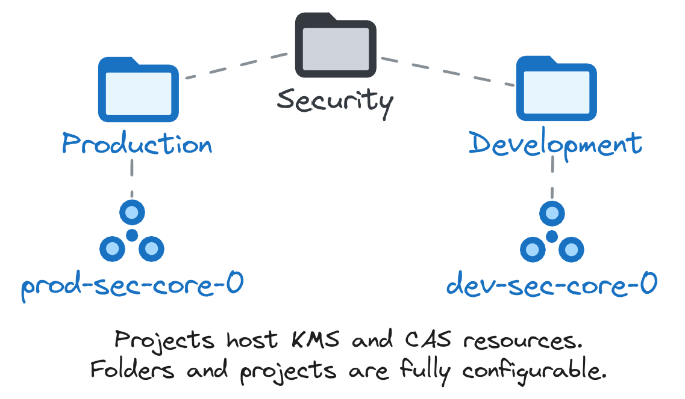

# Shared Security Resources

This stage sets up an area dedicated to hosting security resources and configurations which impact the whole organization, or are shared across the hierarchy to other projects and teams.

Like other modern FAST stage, the resource design is defined here via YAML configuration files and implemented via factories to provide maximum flexibility. A sample reference design compatible with legacy FAST is provided in an initial dataset, and can be used as-is or used as a basis for customizations.

The following diagram illustrates the high-level design of resources implemented in the default dataset:

<p align="center">
  
</p>

<!-- BEGIN TOC -->
- [Quickstart](#quickstart)
  - [Factory data set](#factory-data-set)
  - [Defaults file](#defaults-file)
  - [Terraform vars configuration](#terraform-vars-configuration)
  - [Linking FAST output files](#linking-fast-output-files)
  - [Terraform init/apply cycle](#terraform-initapply-cycle)
- [Design overview and choices](#design-overview-and-choices)
  - [Cloud KMS](#cloud-kms)
  - [Certificate Authority Service (CAS)](#certificate-authority-service-cas)
  - [Hierarchical Security Policies](#hierarchical-security-policies)
- [Files](#files)
- [Variables](#variables)
- [Outputs](#outputs)
<!-- END TOC -->

## Quickstart

This stage is designed to be applied after stage 0, but as any other FAST stage it can also be used in isolation, provided the required prerequisites are met. This section details the FAST usage, where prerequisited are already in place.

The high-level flow for running this stage is:

- check the **factory data set** and do any necessary edits to match your configuration (number of projects, names, KMS keys, CAs, etc.)
- populate the **defaults file** with attributes matching your configuration
- define a simple tfvars file if your dataset is in a non-standard path, and/or you want local output files (recommended for initial setups)
- bring in or link the prerequisite files generated by the previous stage
- run `terraform init` and `apply`

### Factory data set

The default dataset provides two projects, each rooted in a separate folder. I does not define any KMS or CAS resources.

If a different folder or project configuration is needed copy the full dataset to a different path to avoid accidental changes from upstream, then add or remove files in `data/folders` and `data/projects`.

A simple KMS keyrin is provided in `keyrings` folder, use it as an example if more are needed. For CAS too a sample configuration is already present, but the Certificate Authorities factory is disabled by default. If CAS is needed define the `factories_config.paths.certificate_authorities` variable attribute in your tfvars and set it to the path of the relevant data folder (`data/certificate-authorities` by default) as shown in this snippet.

```hcl
factories_config = {
  paths = {
    certificate_authorities = "certificate-authorities"
  }
}
```

### Defaults file

Configurations defaults are stored in the `defaults.yaml` file in the selected dataset. Relocating the defaults file is good practice to avoid accindetal changes from upstream, this is done via the `factories_config.paths.default` variable attribute.

Once a suitable place has been found for the file, edit it to match the desired configuration. Several pieces of information coming from the previous stage (prefix, billing account, etc.) are pre-populated in the project defaults so they don't need to be explicitly set. If some of them need to be overridden, the attributes in `projects.overrides` take precedence as shown in this annotated sample.

```yaml
context:
  # external definitions can be set here and used in context from YAML files
  # locations.primary is used by the default dataset, and should be defined
  locations:
    primary: europe-west1
    secondary: europe-west3
# defaults and overrides common to security projects should go here
# defining storage_location is required
projects:
  defaults:
    storage_location: eu
  # overrides are optional, and can be used to override some FAST defaults
  overrides:
    # don't do this unless you have a good reason :
    prefix: foo-0
```

### Terraform vars configuration

A tfvars file allows you to control paths for the project factories data, and to enable local output files generation. This example shows how to override all the factory paths while also enabling the CAS factory, and how to enable output files.

```hcl
factories_config = {
  dataset = "datasets/mydataset"
  paths = {
    certificate_authorities = "certificate-authorities"
    # the following default to relative paths in the dataset
    # defaults                = "defaults.yaml"
    # folders                 = "folders"
    # keyrings                = "keyrings"
    # projects                = "projects"
  }
}
outputs_location = "~/fast-config"
```

### Linking FAST output files

If you enabled local output files in the previous stage, run this command replacing the example path with the one for your output files.

```bash
../fast-links.sh ~/fast-config

# File linking commands for security stage

# provider file
ln -s ~/fast-config/providers/2-security-providers.tf ./

# input files from other stages
ln -s ~/fast-config/tfvars/0-globals.auto.tfvars.json ./
ln -s ~/fast-config/tfvars/0-org-setup.auto.tfvars.json ./

# conventional location for this stage terraform.tfvars (manually managed)
ln -s ~/fast-config/2-security.auto.tfvars ./
```

If you have no local output files, check the previous state's outputs for the name of your GCS outputs bucket and replace it in the example below.

```bash
../fast-links.sh gs://myprefix-prod-iac-org-0-iac-outputs

# File linking commands for security stage

# provider file
gcloud storage cp gs://myprefix-prod-iac-org-0-iac-outputs/providers/2-security-providers.tf ./

# input files from other stages
gcloud storage cp gs://myprefix-prod-iac-org-0-iac-outputs/tfvars/0-globals.auto.tfvars.json ./
gcloud storage cp gs://myprefix-prod-iac-org-0-iac-outputs/tfvars/0-org-setup.auto.tfvars.json ./

# conventional location for this stage terraform.tfvars (manually managed)
gcloud storage cp gs://myprefix-prod-iac-org-0-iac-outputs/2-security.auto.tfvars ./
```

Once you have one of the above outputs, copy/paste it in your terminal from within this stage's folder.

Note that the last command in both outputs is optional: this is our recommended best practice to centrally store the tfvars file you created for this stage. If this convention works for you, move the tfvars file created in the previous steps to the path shown in the output, then run the command.

### Terraform init/apply cycle

Once everything is set up, simply run the usual `init`/`apply` cycle.

```bash
terraform init
terraform apply
```

## Design overview and choices

Project-level security resources are grouped into one project per environment. This setup matches requirements we frequently observe in real life and provides enough separation without needlessly complicating operations.

Cloud KMS is configured and designed mainly to encrypt GCP resources with a [Customer-managed encryption key](https://cloud.google.com/kms/docs/cmek) but it may be used to create cryptokeys used to [encrypt application data](https://cloud.google.com/kms/docs/encrypting-application-data) and other uses.

A single [Certificate Authority Service](https://cloud.google.com/security/products/certificate-authority-service?hl=en) pool and CA are configured by default, but the setup can be easily extended to support multiple resources in any environment.

IAM for day to day operations is already assigned at the folder level to the security team by the previous stage, but more granularity can be added here to grant control of separate services across environments to different actors.

### Cloud KMS

A reference Cloud KMS implementation is part of this stage, to provide a simple way of managing centralized keys, that are then shared and consumed widely across the organization to enable customer-managed encryption. The implementation is also easy to clone and modify to support other services like Secret Manager.

The Cloud KMS configuration allows defining keys by name (typically matching the downstream service that uses them) in different locations. It then takes care internally of provisioning the relevant keyrings and creating keys in the appropriate location.

IAM roles on keys can be configured at the logical level for all locations where a logical key is created. Their management can also be delegated via [delegated role grants](https://cloud.google.com/iam/docs/setting-limits-on-granting-roles) exposed through a simple variable, to allow other identities to set IAM policies on keys. This is particularly useful in setups like project factories, making it possible to configure IAM bindings during project creation for team groups or service agent accounts (compute, storage, etc.).

### Certificate Authority Service (CAS)

A reference Certificate Authority Services (CAS) is also part of this stage, allowing creation of any number of CA pools and authorities. To create custom CAS, the relevant factory variable needs to be configured first as explained above.

### Hierarchical Security Policies

Hierarchical Cloud Armor policies are defined in the `security-policies` directory, one YAML file per policy, and managed via the [`net-cloud-armor`](../../../modules/net-cloud-armor/) module. The networking and security stages share the same factory, so each stage can manage its own policies.

```yaml
# yaml-language-server: $schema=../../../schemas/security-policy.schema.json

parent_id:
  organization_id: $folder_ids:organization
attachments:
  organization:
    id: $folder_ids:organization
    excluded_folders:
      - $folder_ids:sandbox
rules:
  trusted:
    priority: 10
    action: goto_next
    match:
      src_ip_ranges:
        - $cidr_ranges_sets:trusted
  deny-blocked:
    priority: 100
    action: deny(403)
    match:
      src_ip_ranges:
        - $cidr_ranges_sets:blocked
```

- Policies are owned by the organization or a folder, and attached to the organization, folders or projects via `attachments`.
- Folder ids, project numbers, and CIDR ranges in rules, attachments and exclusions can use context references (`$folder_ids:`, `$project_numbers:`, `$cidr_ranges:`, `$cidr_ranges_sets:`).
- Each node in the hierarchy can only have one Cloud Armor policy attached, so the networking and security stages cannot attach policies to the same node. Policy names must be unique in the organization.
- Projects under an attached policy are automatically enrolled in Cloud Armor Enterprise, which is billed per project. The shipped datasets contain no policies, and exclusions should be defined before a policy is attached.
- Policy ids are passed to the following stages, where the project factory can attach them to folders via `$security_policies:` references.

Attaching policies from the project factory stage requires granting its service accounts permission to use and read policies at the organization level in `0-org-setup` (`organization/.config.yaml`):

```yaml
iam_by_principals:
  $iam_principals:service_accounts/iac-0/iac-pf-rw:
    - roles/compute.orgSecurityPolicyUser
  $iam_principals:service_accounts/iac-0/iac-pf-ro:
    - $custom_roles:org_security_policy_viewer
```

<!-- TFDOC OPTS files:1 show_extra:1 exclude:2-security-providers.tf -->
<!-- BEGIN TFDOC -->
## Files

| name | description | modules | resources |
|---|---|---|---|
| [factory-cas.tf](./factory-cas.tf) | None | <code>certificate-authority-service</code> |  |
| [factory-keyrings.tf](./factory-keyrings.tf) | None | <code>kms</code> |  |
| [factory-projects.tf](./factory-projects.tf) | None | <code>project-factory</code> |  |
| [factory-security-policies.tf](./factory-security-policies.tf) | Security policies factory. | <code>net-cloud-armor</code> |  |
| [main.tf](./main.tf) | Module-level locals and resources. |  |  |
| [outputs.tf](./outputs.tf) | Module outputs. |  | <code>google_storage_bucket_object</code> · <code>local_file</code> |
| [variables-fast.tf](./variables-fast.tf) | None |  |  |
| [variables.tf](./variables.tf) | Module variables. |  |  |

## Variables

| name | description | type | required | default | producer |
|---|---|:---:|:---:|:---:|:---:|
| [billing_account](variables-fast.tf#L17) | Billing account id. | <code>object&#40;&#123;&#8230;&#125;&#41;</code> | ✓ |  | <code>0-org-setup</code> |
| [organization](variables-fast.tf#L49) | Organization details. | <code>object&#40;&#123;&#8230;&#125;&#41;</code> | ✓ |  | <code>0-org-setup</code> |
| [prefix](variables-fast.tf#L66) | Prefix used for resources that need unique names. Use a maximum of 9 chars for organizations, and 11 chars for tenants. | <code>string</code> | ✓ |  | <code>0-org-setup</code> |
| [context](variables.tf#L17) | Context-specific interpolations. | <code>object&#40;&#123;&#8230;&#125;&#41;</code> |  | <code>&#123;&#125;</code> |  |
| [custom_roles](variables-fast.tf#L25) | Custom roles defined at the org level, in key => id format. | <code>map&#40;string&#41;</code> |  | <code>&#123;&#125;</code> | <code>0-org-setup</code> |
| [factories_config](variables.tf#L45) | Configuration for the resource factories or external data. | <code>object&#40;&#123;&#8230;&#125;&#41;</code> |  | <code>&#123;&#125;</code> |  |
| [folder_ids](variables-fast.tf#L33) | Folders created in the bootstrap stage. | <code>map&#40;string&#41;</code> |  | <code>&#123;&#125;</code> | <code>0-org-setup</code> |
| [iam_principals](variables-fast.tf#L41) | IAM-format principals. | <code>map&#40;string&#41;</code> |  | <code>&#123;&#125;</code> | <code>0-org-setup</code> |
| [perimeters](variables-fast.tf#L58) | Optional VPC-SC perimeter ids. | <code>map&#40;string&#41;</code> |  | <code>&#123;&#125;</code> | <code>1-vpcsc</code> |
| [project_ids](variables-fast.tf#L76) | Projects created in the bootstrap stage. | <code>map&#40;string&#41;</code> |  | <code>&#123;&#125;</code> | <code>0-org-setup</code> |
| [service_accounts](variables-fast.tf#L84) | Service accounts created in the bootstrap stage. | <code>map&#40;string&#41;</code> |  | <code>&#123;&#125;</code> | <code>0-org-setup</code> |
| [storage_buckets](variables-fast.tf#L92) | Storage buckets created in the bootstrap stage. | <code>map&#40;string&#41;</code> |  | <code>&#123;&#125;</code> | <code>0-org-setup</code> |
| [tag_keys](variables-fast.tf#L100) | FAST-managed resource manager tag keys. | <code>map&#40;string&#41;</code> |  | <code>&#123;&#125;</code> | <code>0-org-setup</code> |
| [tag_values](variables-fast.tf#L108) | FAST-managed resource manager tag values. | <code>map&#40;string&#41;</code> |  | <code>&#123;&#125;</code> | <code>0-org-setup</code> |
| [tag_vars](variables-fast.tf#L116) | FAST-managed resource manager tag key namespaced names. | <code>object&#40;&#123;&#8230;&#125;&#41;</code> |  | <code>&#123;&#125;</code> | <code>0-org-setup</code> |
| [universe](variables-fast.tf#L127) | GCP universe where to deploy projects. The prefix will be prepended to the project id. | <code>object&#40;&#123;&#8230;&#125;&#41;</code> |  | <code>null</code> | <code>0-org-setup</code> |

## Outputs

| name | description | sensitive | consumers |
|---|---|:---:|---|
| [ca_ids](outputs.tf#L95) | Certificate Authority Service CA IDs. |  |  |
| [ca_pools](outputs.tf#L100) | Certificate Authority Service pool IDs. |  |  |
| [kms_keys_ids](outputs.tf#L105) | KMS keys IDs. |  |  |
| [security_policies](outputs.tf#L110) | Hierarchical security policy ids. |  |  |
| [tfvars](outputs.tf#L115) | Terraform variable files for the following stages. | ✓ |  |
<!-- END TFDOC -->
